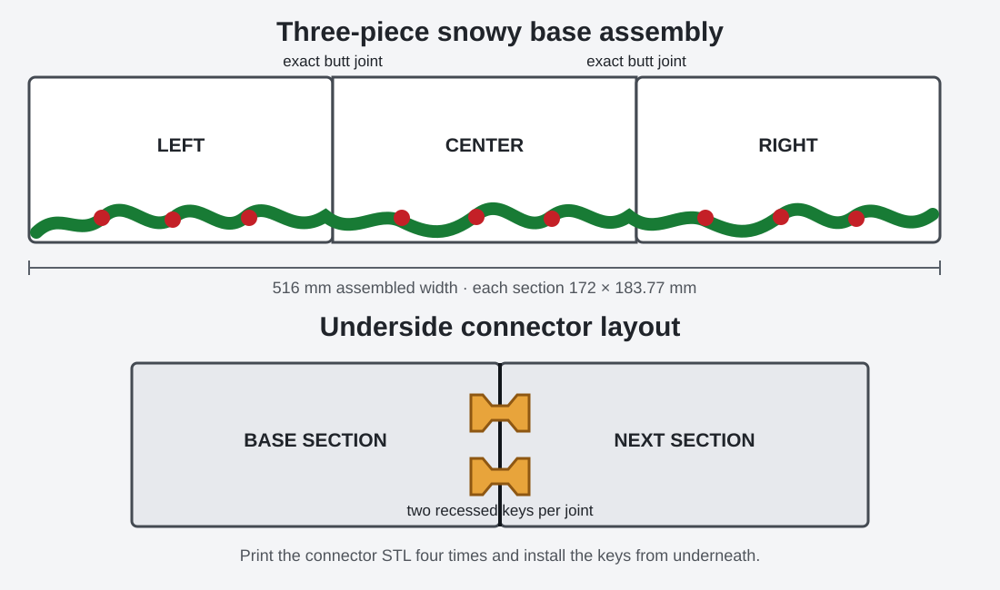
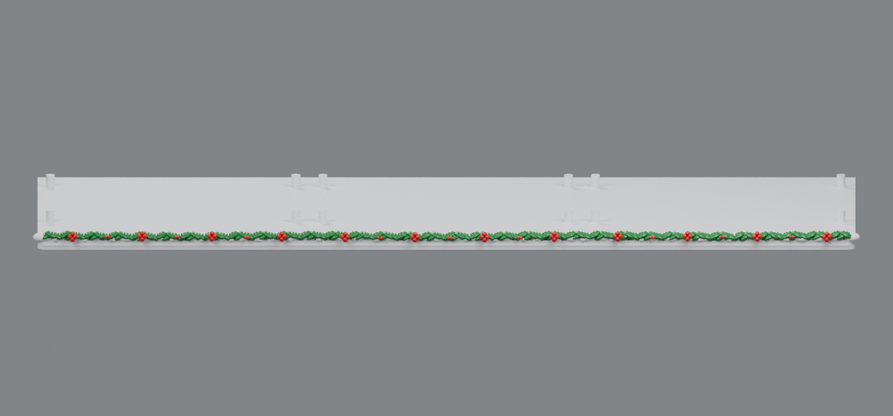
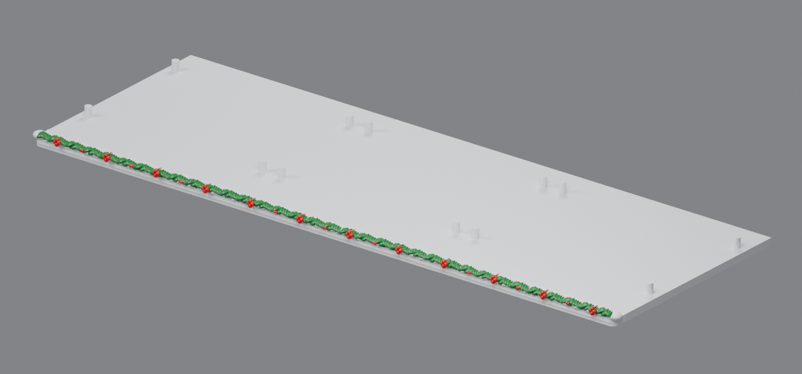
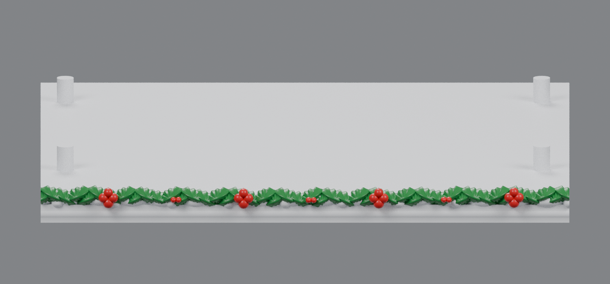
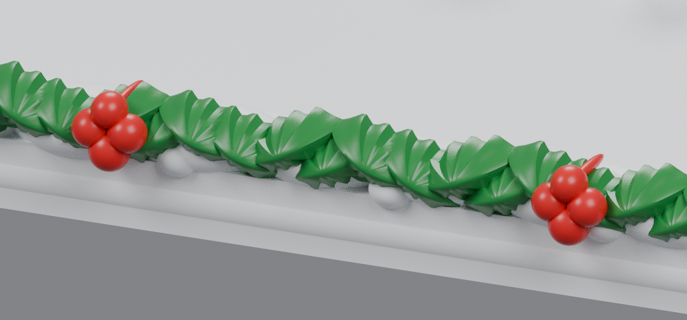

# Snowy three-piece base v1

This revision turns `base_rev32.stl` into a continuous 516 mm display base that prints as three separate sections. The original 172 × 168 mm mounting area and all four mounting pins remain exact on every section. A rounded front plinth, uneven snow bank, two overlapping rows of holly, large four-berry clusters, and smaller berry accents replace the original front snow beads. Peppermint discs are omitted.

The color in the previews is a paint guide. Each download is a single fused STL.

## Direct downloads

- [Left snowy base v1](https://raw.githubusercontent.com/brucebentle-del/codex-workspace/refs/heads/main/base-customization-v1/left_snowy_base_v1.stl)
- [Center snowy base v1](https://raw.githubusercontent.com/brucebentle-del/codex-workspace/refs/heads/main/base-customization-v1/center_snowy_base_v1.stl)
- [Right snowy base v1](https://raw.githubusercontent.com/brucebentle-del/codex-workspace/refs/heads/main/base-customization-v1/right_snowy_base_v1.stl)
- [Bow-tie connector key — print four copies](https://raw.githubusercontent.com/brucebentle-del/codex-workspace/refs/heads/main/base-customization-v1/base_connector_key_print_4.stl)

## Assembly

Each joint has two recessed underside pockets. Print four keys total, place two beneath the left/center joint and two beneath the center/right joint, and push the full-height side faces together on a flat surface. The pockets include 0.25 mm clearance around the key and 0.6 mm vertical clearance. A small amount of adhesive can be used after the test fit.

## Print size and orientation

- Each base section: **172 × 183.77 × 14 mm**
- Complete assembly: **516 × 183.77 × 14 mm**
- Connector key: **18 × 11.2 × 3.6 mm**
- Print every base section flat with its broad underside on the build plate, at 100% scale in millimeters.
- The three sections fit a 256 × 256 mm build plate individually.
- Print the connector key flat and make four copies.
- The model is one connected watertight solid per section. Enable build-plate-only organic supports only if the slicer flags the lowest berry surfaces.

## Previews

The following close-up is centered on an internal cut line. The holly and snow profiles come from one continuous model before the exact split, so they meet without a modeled gap.

## Validation

- All three STLs are watertight, consistently wound, positive-volume meshes with one connected printable component.
- The original top and mounting-pin geometry differs from `base_rev32.stl` by no more than `1.21e-14 mm` in the protected fit region.
- Both adjoining face pairs have identical cross-sections; measured symmetric-difference area is `0.0 mm²`.
- Reassembling the exported STLs produces one Boolean body; its volume differs from the sum of the three sections by `1.16e-10 mm³`.
- The connector is watertight and uses four underside pockets at Y = 55 and 115 mm.

See [validation-report.json](validation-report.json) for the machine-readable results.
