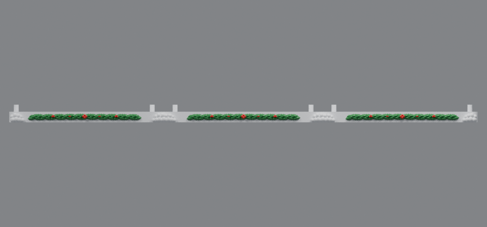
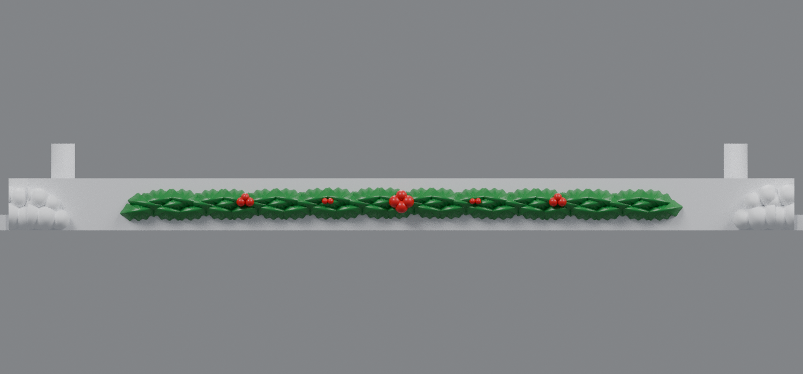

# Vertically centered thick-holly snowy bases (v10)

V10 lowers the complete v9 holly-and-berry decoration by **1.813624 mm** on the left, center, and right bases. The decoration now spans Z=**1.853251–10.146749 mm**, placing its center exactly at Z=**6.000 mm** on the 12 mm front face.

The three staggered rows, 183 roof-width leaves, berry layouts, snow piles, housing posts, connectors, and split seam extensions are unchanged from v9.

## Downloads

- [Left snowy base v10 for rev91 housing](https://raw.githubusercontent.com/brucebentle-del/codex-workspace/refs/heads/main/base-customization-v10/left_snowy_base_rev91_centered_thick_holly_v10.stl)
- [Center snowy base v10 for rev66 housing](https://raw.githubusercontent.com/brucebentle-del/codex-workspace/refs/heads/main/base-customization-v10/center_snowy_base_rev66_centered_thick_holly_v10.stl)
- [Right snowy base v10 for rev91 housing](https://raw.githubusercontent.com/brucebentle-del/codex-workspace/refs/heads/main/base-customization-v10/right_snowy_base_rev91_centered_thick_holly_v10.stl)

Print each STL flat at 100% scale in millimeters.

## Validation

- Holly center: **Z=6.000 mm**
- Front-face center: **Z=6.000 mm**
- Vertical center error: **0.000 mm**
- Two diagonal posts remain aligned to the rev91 side and rev66 center housings
- Original v7 bow-tie connector geometry remains unchanged
- Both visible assembly seams remain gap-free
- All three STLs remain watertight, consistently wound, single-component solids
- All three STLs fit a 256 mm square printer bed

See [validation-report.json](validation-report.json) and [design-dimensions.json](design-dimensions.json) for the measured checks.
