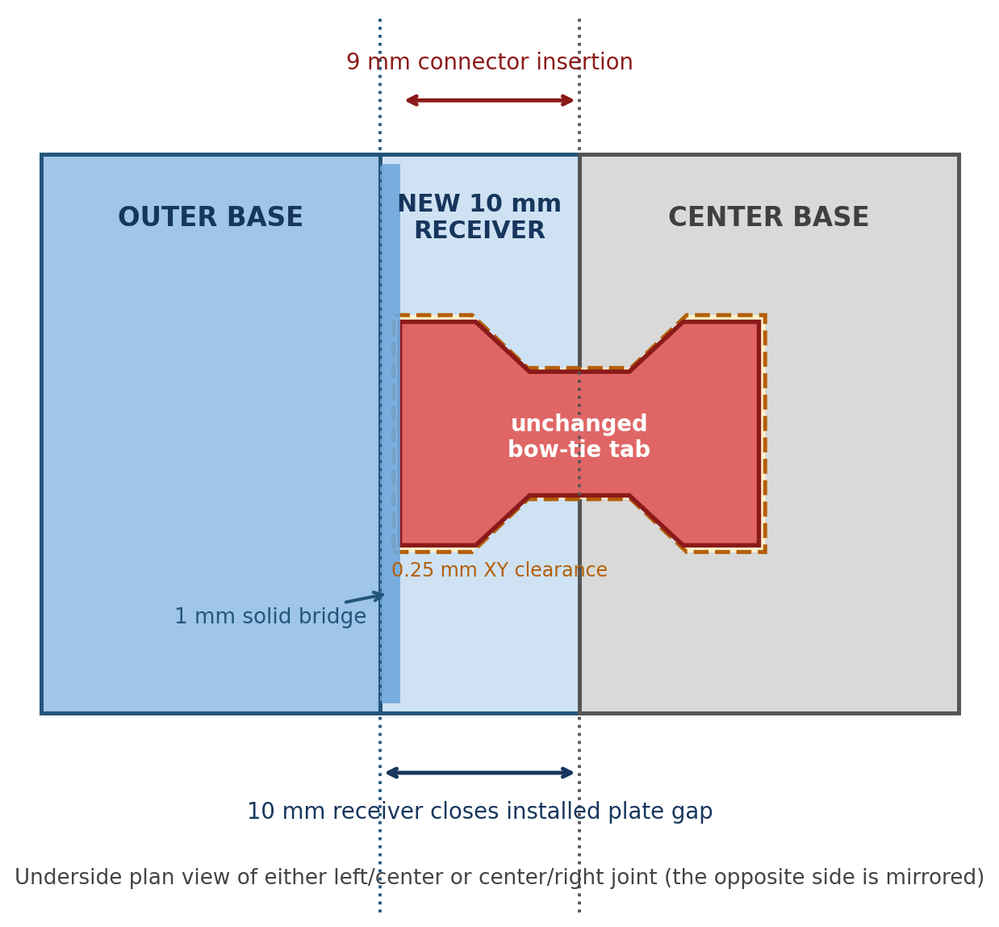
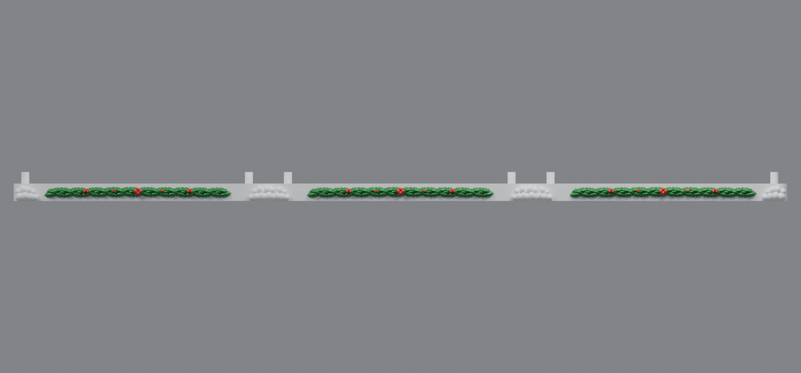

# Engaged-connector snowy bases (v11)

V11 corrects the disconnected joint visible in the printed v10 bases. The lower housings hold neighboring original plates approximately **10 mm apart**. V10 assumed 9 mm and retained receiving pockets at the original plate edges, so its bow-tie tabs crossed the opening but did not enter either outer base.

Each v11 outer base now has a **10 mm structural receiver extension** with two matching underside pockets. The existing center bow-tie tabs retain their original shape and position and insert **9 mm** into those receivers. A **1 mm solid bridge** connects each tab pocket back to the original outer plate.

The split snowy front edges are now **5 mm per adjoining base**, closing each measured 10 mm installed opening without overlap.

## Downloads

- [Left snowy base v11 for rev91 housing](https://raw.githubusercontent.com/brucebentle-del/codex-workspace/refs/heads/main/base-customization-v11/left_snowy_base_rev91_engaged_connectors_v11.stl)
- [Center snowy base v11 for rev66 housing](https://raw.githubusercontent.com/brucebentle-del/codex-workspace/refs/heads/main/base-customization-v11/center_snowy_base_rev66_engaged_connectors_v11.stl)
- [Right snowy base v11 for rev91 housing](https://raw.githubusercontent.com/brucebentle-del/codex-workspace/refs/heads/main/base-customization-v11/right_snowy_base_rev91_engaged_connectors_v11.stl)

Print each STL flat at 100% scale in millimeters.

## How the joint connects

1. Place the center and one outer base with their undersides accessible.
2. Align both bow-tie tabs with the two receiver pockets.
3. Slide the outer base toward the center until the structural plate edges meet.
4. Repeat for the opposite side.
5. Install the three lower housings onto their two diagonal mounting posts.

The left/center and center/right joints are mirrored copies of the diagram.

## Validation

- Measured installed structural opening: **10 mm**
- Outer receiver depth: **10 mm**
- Connector insertion into each receiver: **9 mm**
- Connector-to-receiver collision: **0 mm³**
- Structural top-plate gap after assembly: **0 mm** at both joints
- Snow/plinth gap after assembly: **0 mm** at both joints
- Center connector region difference from v7/v10: **0 mm³**
- Holly and berries remain centered at Z=**6.000 mm**
- Two diagonal posts remain aligned with the rev91 side and rev66 center housings
- All three STLs are watertight, consistently wound, single-component solids
- All three STLs fit a 256 mm square printer bed

See [validation-report.json](validation-report.json) and [design-dimensions.json](design-dimensions.json) for the measured geometry checks.
