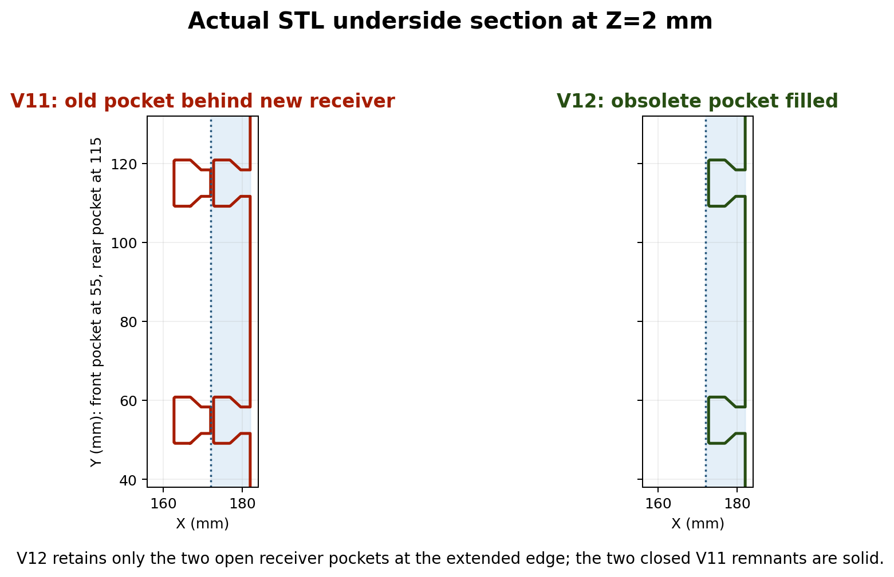
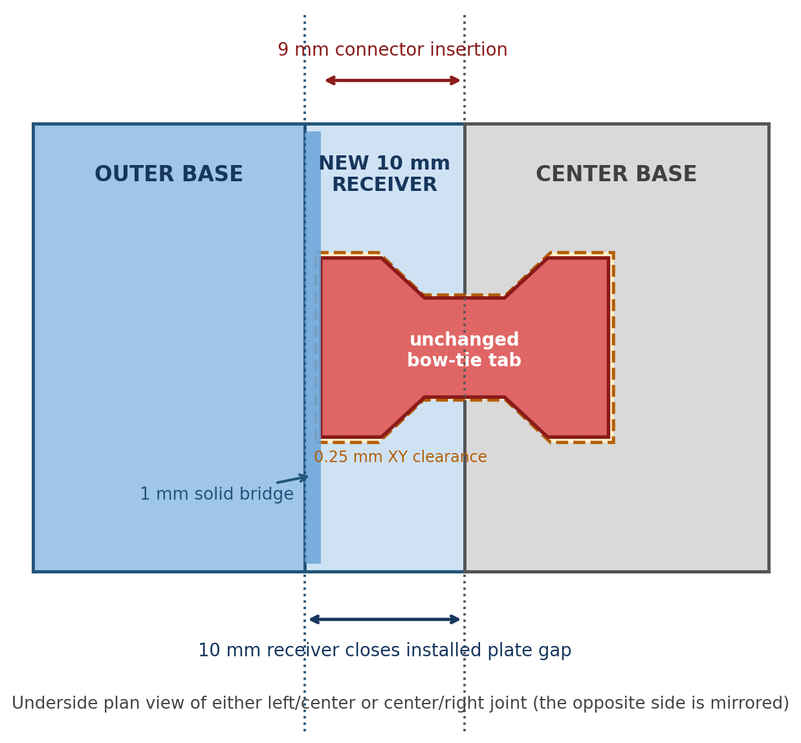
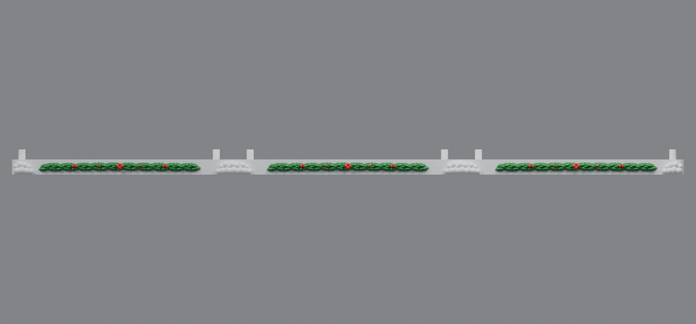

# Single-receiver outer snowy bases (v12)

V12 removes the unused original bow-tie pockets that remained behind the new v11 receiver pockets. Each left/right joint now has exactly **one front receiver and one rear receiver**. The center base and its connector tabs are unchanged.

## What changed

- **Left base:** two obsolete closed pockets filled
- **Right base:** two obsolete closed pockets filled
- **Center base:** byte-for-byte identical to v11
- New 10 mm receivers and 9 mm connector engagement retained
- Five-millimeter split snow edges and zero-gap plate geometry retained

Only the **left and right bases need to be reprinted** when upgrading from v11.

## Downloads

- [Left snowy base v12 for rev91 housing](https://raw.githubusercontent.com/brucebentle-del/codex-workspace/refs/heads/main/base-customization-v12/left_snowy_base_rev91_single_receiver_v12.stl)
- [Right snowy base v12 for rev91 housing](https://raw.githubusercontent.com/brucebentle-del/codex-workspace/refs/heads/main/base-customization-v12/right_snowy_base_rev91_single_receiver_v12.stl)
- [Center snowy base v12 for rev66 housing](https://raw.githubusercontent.com/brucebentle-del/codex-workspace/refs/heads/main/base-customization-v12/center_snowy_base_rev66_single_receiver_v12.stl) — included for completeness; identical to v11

Print flat at 100% scale in millimeters.

## Connection

The center retains two tabs per joint: one front and one rear. Each tab slides into the corresponding single open receiver on the outer base.

## Validation

- Old-pocket solid-fill samples: **0.064 mm³ each**, matching the complete sample volume
- New receiver void samples: **0 mm³ material**, confirming the intended pockets remain open
- Center STL checksum matches v11: `ca05ca995de2a1e4819046259c6d1656456d66bafe75896e574452ec100c0da9`
- Center connector-region change: **0 mm³**
- Connector insertion: **9 mm**
- Connector collision: **0 mm³**
- Structural and snowy seam gaps: **0 mm**
- All STLs remain watertight, consistently wound, single-component solids

See [validation-report.json](validation-report.json) and [design-dimensions.json](design-dimensions.json) for all measurements.
