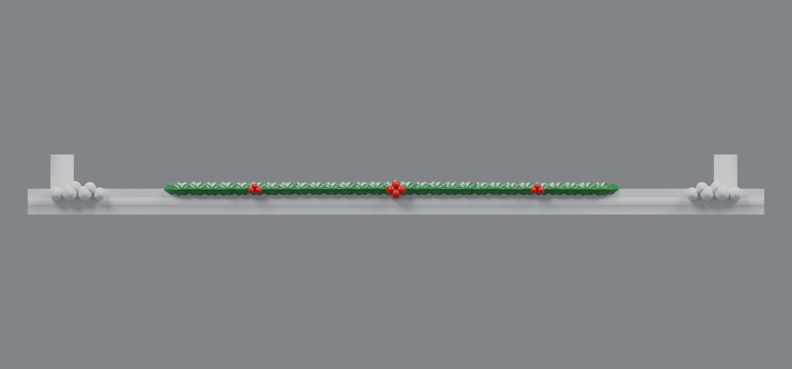
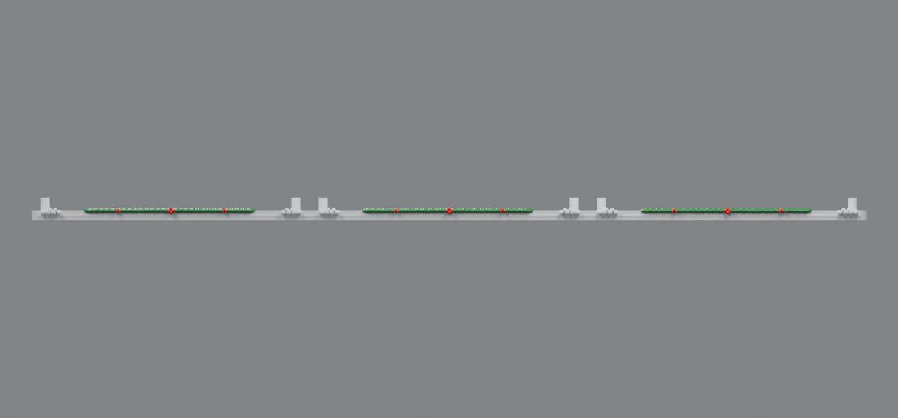
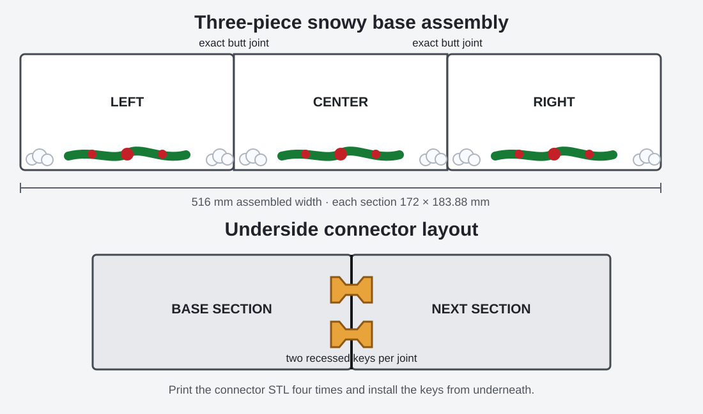
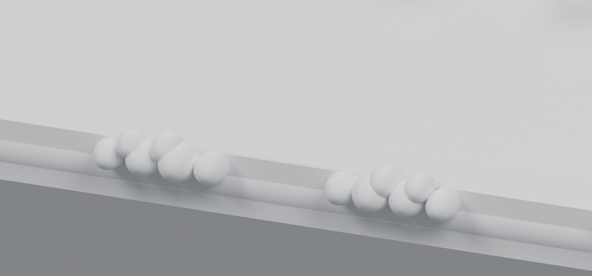
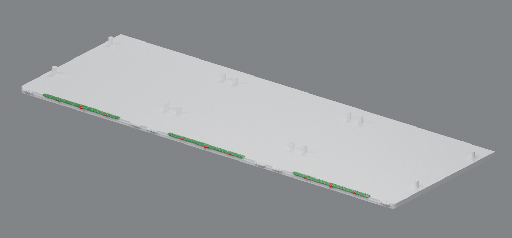

# Three-sprig snowy base v2

This revision replaces the continuous garland from v1 with three independent focal sprigs—one centered on each printable base section. Every sprig uses two overlapping rows of holly, a prominent four-berry center cluster, and two smaller three-berry clusters. Compact six-ball snow piles flank each sprig without crossing a section joint.

The original 172 × 168 mm mounting area and all four mounting pins remain exact on every section. Peppermint discs remain omitted. Preview colors are a paint guide; each download is one fused STL.

## Direct downloads

- [Left snowy base v2](https://raw.githubusercontent.com/brucebentle-del/codex-workspace/refs/heads/main/base-customization-v2/left_snowy_base_v2.stl)
- [Center snowy base v2](https://raw.githubusercontent.com/brucebentle-del/codex-workspace/refs/heads/main/base-customization-v2/center_snowy_base_v2.stl)
- [Right snowy base v2](https://raw.githubusercontent.com/brucebentle-del/codex-workspace/refs/heads/main/base-customization-v2/right_snowy_base_v2.stl)
- [Bow-tie connector key — print four copies](https://raw.githubusercontent.com/brucebentle-del/codex-workspace/refs/heads/main/base-customization-v2/base_connector_key_print_4.stl)

## Front arrangement

The upright posts visible in these bare-base previews are the original mounting pins. The building sections cover them after assembly.

## Assembly

Each joint has two recessed underside pockets. Print four keys total, place two beneath the left/center joint and two beneath the center/right joint, and push the full-height side faces together on a flat surface. The pockets include 0.25 mm clearance around the key and 0.6 mm vertical clearance.

## Print size and drawer clearance

- Each base section: **172 × 183.88 × 14 mm**
- Complete assembly: **516 × 183.88 × 14 mm**
- Connector key: **18 × 11.2 × 3.6 mm**
- Print each base flat, at 100% scale in millimeters. Each section fits a 256 × 256 mm build plate.
- Print the connector key flat and make four copies.
- The uploaded base's original front snow reached **7.996 mm**. Every new sprig, berry, and snowball remains at or below **7.980 mm**, preserving that original drawer-clearance envelope.
- Each section is one connected watertight body. Build-plate-only organic supports can be enabled if the slicer flags the lowest front details.

## Additional preview

## Validation

- All three STLs are watertight, consistently wound, positive-volume meshes with one connected printable component.
- The original mounting region and all four pins match `base_rev32.stl` within `1.21e-14 mm`.
- Both adjoining face pairs have identical cross-sections; measured symmetric-difference area is `0.0 mm²`.
- Reassembling the three exported STLs produces one Boolean body with `0.0 mm³` volume difference from the sum of the sections.
- The four recessed keys and both exact butt joints are unchanged from v1.

See [validation-report.json](validation-report.json), [snow-placement.json](snow-placement.json), and [holly-placement.json](holly-placement.json) for machine-readable details.
