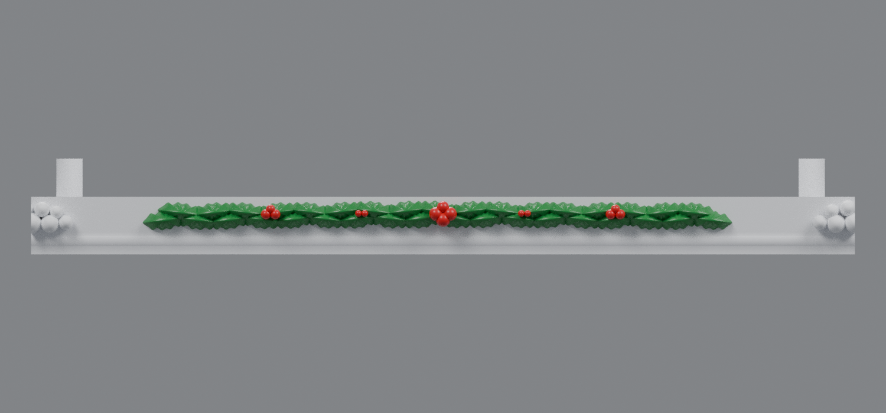
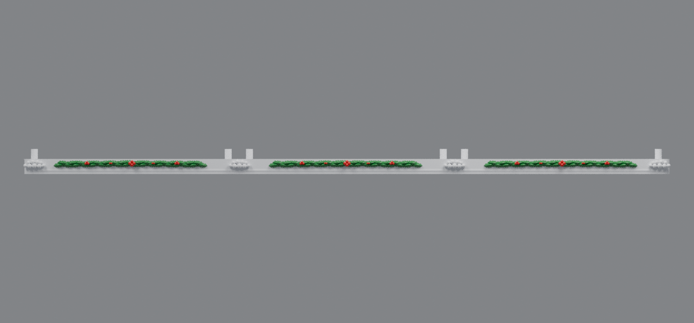
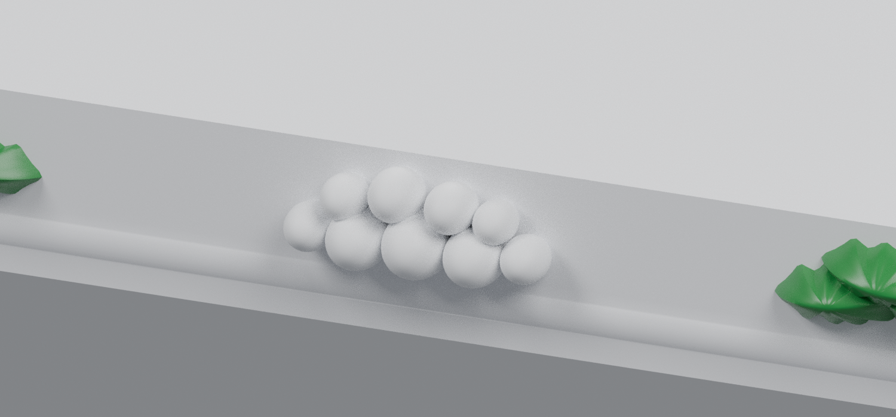
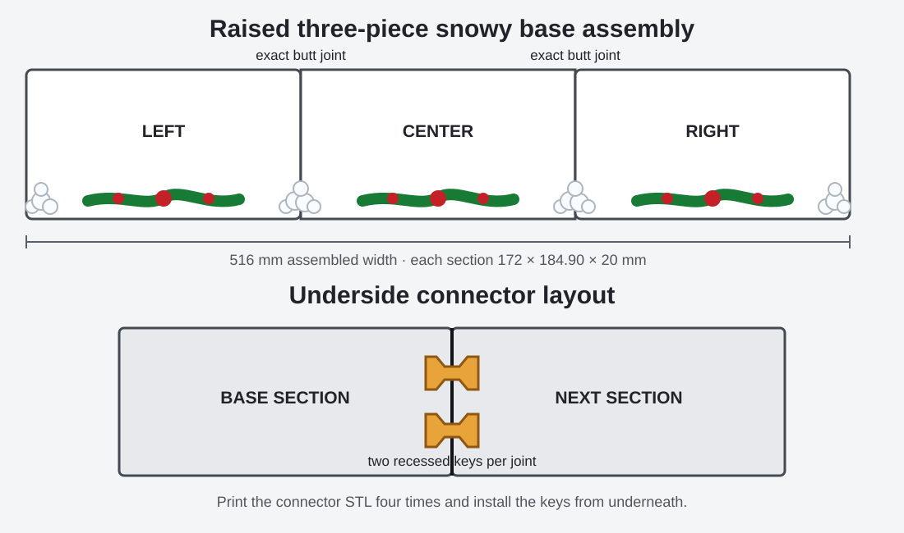
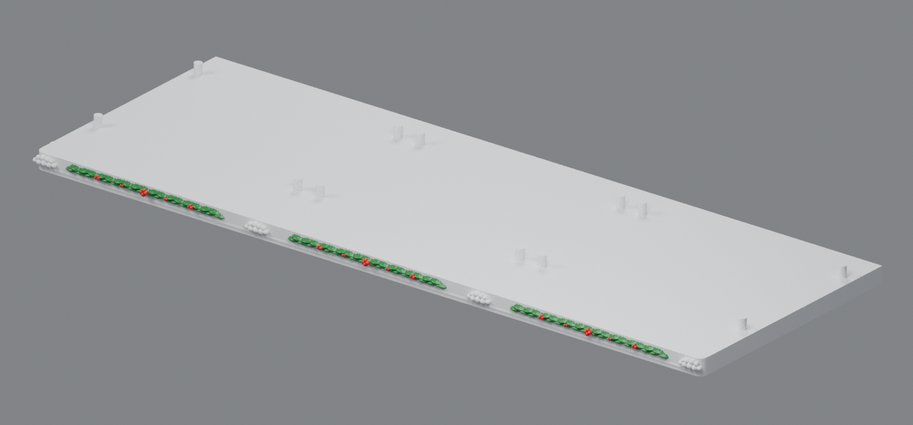

# Raised reference-style snowy base v3

This is an earlier version. The current [v4 base](../base-customization-v4/README.md) lowers and enlarges the snowball mounds and moves the extreme outside balls inward.

This revision follows the supplied reference more closely with taller, fuller two-layer holly, a bold four-berry center, medium three-berry clusters, and smaller paired berry accents. Four snowball mounds replace the peppermint-disc locations. The two internal mounds are modeled whole and split exactly at the base joints, placing one complementary half on each adjoining STL.

The original mounting plate and all four pins are translated upward together by 6 mm. Their dimensions and relative fit remain unchanged. This creates a 12 mm-high front face for the larger decoration while keeping every leaf, berry, and snowball below the building-support plane.

Preview colors are a paint guide; each download is one fused STL.

## Direct downloads

- [Left snowy base v3](https://raw.githubusercontent.com/brucebentle-del/codex-workspace/refs/heads/main/base-customization-v3/left_snowy_base_v3.stl)
- [Center snowy base v3](https://raw.githubusercontent.com/brucebentle-del/codex-workspace/refs/heads/main/base-customization-v3/center_snowy_base_v3.stl)
- [Right snowy base v3](https://raw.githubusercontent.com/brucebentle-del/codex-workspace/refs/heads/main/base-customization-v3/right_snowy_base_v3.stl)
- [Bow-tie connector key — print four copies](https://raw.githubusercontent.com/brucebentle-del/codex-workspace/refs/heads/main/base-customization-v3/base_connector_key_print_4.stl)

## Reference-style front

The center STL contains half of a snowball mound at each end. The left and right STLs carry the matching halves.

The upright posts in the bare-base previews are the original mounting pins. The buildings cover them after assembly.

## Split snowball mounds and connectors

Both internal mounds are created before the full base is split. Their cut surfaces therefore match the same exact joint plane as the white base. Two recessed underside bow-tie keys align each joint; print the connector STL four times.

## Dimensions and clearance

- Each section: **172 × 184.90 × 20 mm**
- Complete assembly: **516 × 184.90 × 20 mm**
- Original mounting geometry raised: **6 mm**
- Raised building-support plane: **Z = 12 mm**
- Highest decoration: **Z = 11.32 mm**
- Clearance beneath the building-support plane: **0.68 mm**
- Connector key: **18 × 11.2 × 3.6 mm**
- Every section fits a 256 × 256 mm build plate.

Print each base flat at 100% scale in millimeters. Print the connector flat and make four copies. Build-plate-only organic supports can be enabled if the slicer flags the front leaves, berries, or snowballs.

## Additional preview

## Validation

- All three STLs are watertight, consistently wound, positive-volume meshes with one connected printable component.
- The translated mounting surfaces and pins match `base_rev32.stl` within `1.21e-14 mm`.
- Both joint face pairs, including the divided snowball mounds, have `0.0 mm²` symmetric-difference area.
- Reassembling all three exported STLs produces one Boolean body; its volume differs from the sum of the sections by only `2.33e-10 mm³`.
- All decoration remains below the raised building-support plane.

See [validation-report.json](validation-report.json), [snow-placement.json](snow-placement.json), and [holly-placement.json](holly-placement.json) for machine-readable details.
