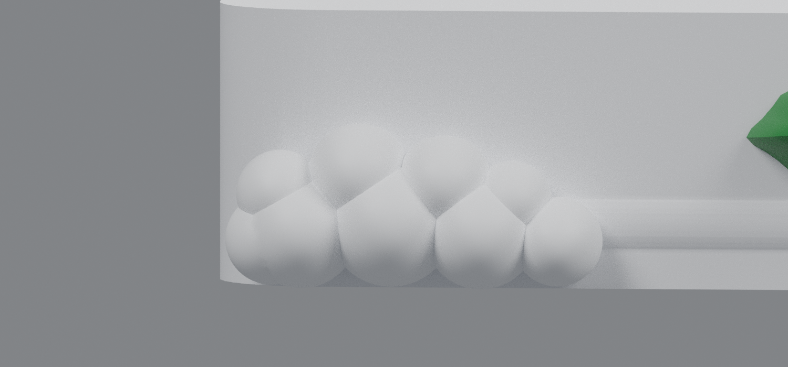
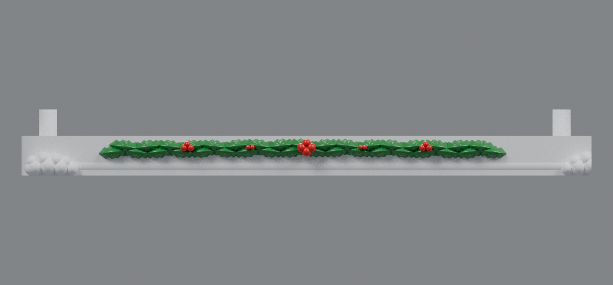

# Lowered and enlarged snowy-base mounds (v4)

This revision lowers the snowball mounds to the bottom of the plate and enlarges every snowball by 28%. The lowest row now finishes 0.04–0.18 mm above Z=0 instead of beginning around the middle of the front face. The extreme outside ball on the left base moves 2 mm to the right, placing its complete enlarged sphere inside the plate; the right outer pile receives the mirrored correction.

The two internal mounds were rebuilt as complete piles before splitting the assembly. Their left/center and center/right halves therefore retain exact complementary joint faces. The holly, raised mounting plate, pins, connector pockets, drawer clearance, and overall base dimensions are unchanged.

## Downloads

- [Left snowy base v4](https://raw.githubusercontent.com/brucebentle-del/codex-workspace/refs/heads/main/base-customization-v4/left_snowy_base_v4.stl)
- [Center snowy base v4](https://raw.githubusercontent.com/brucebentle-del/codex-workspace/refs/heads/main/base-customization-v4/center_snowy_base_v4.stl)
- [Right snowy base v4](https://raw.githubusercontent.com/brucebentle-del/codex-workspace/refs/heads/main/base-customization-v4/right_snowy_base_v4.stl)
- [Connector key — print four copies](https://raw.githubusercontent.com/brucebentle-del/codex-workspace/refs/heads/main/base-customization-v4/base_connector_key_print_4.stl)

Print each STL flat at 100% scale in millimeters.

## Previews

- [Corrected split mound at an internal joint](assembly-seam-v4.png)
- [Complete three-base assembly](assembly-front-detail-v4.png)
- [Assembly guide](assembly-guide.svg)

## Measurements and validation

- Snowball radius increase: **28%**
- Lowest-row bottom height: **0.04–0.18 mm above Z=0**
- Extreme outer-ball inward movement: **2 mm**
- Left extreme-ball minimum X: **0.816 mm**, fully inside the plate
- Decoration clearance below the building-support plane: **0.733 mm**
- Each section remains **172 × 184.90 × 20 mm** and fits a 256 mm square bed.

All three STLs are watertight, consistently wound, positive-volume meshes with one printable component. Both butt joints have zero cross-section difference, and reassembling the three exported modules produces one Boolean body. The protected mounting geometry matches `base_rev32.stl` within `1.21e-14 mm`.

See [validation-report.json](validation-report.json), [snow-placement.json](snow-placement.json), and [design-dimensions.json](design-dimensions.json) for machine-readable results.
