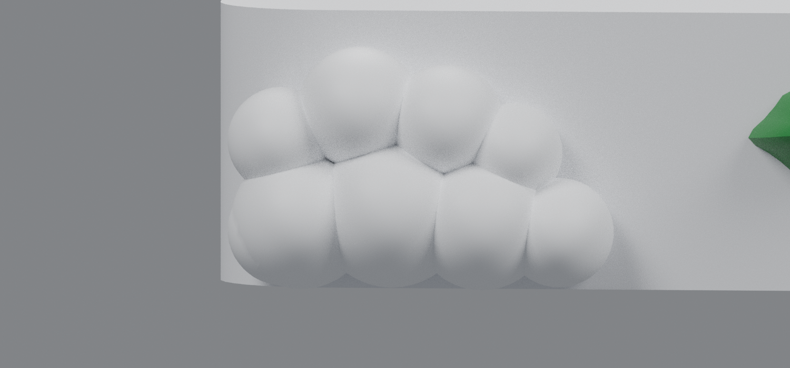
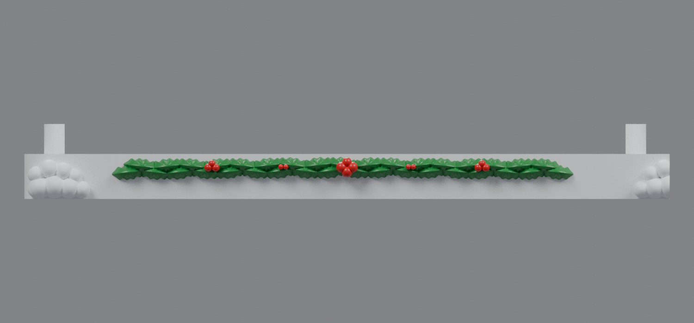

# Taller snowball mounds and clean front face (v5)

The horizontal line visible in v4 was a cylindrical trim rail added across the front of the base. It was model geometry rather than a slicer seam. V5 removes that rail completely, leaving a clean flat front face between the snowball piles.

The piles are now substantially larger and taller. Every snowball is 55% larger than the original v3 size and about 21% larger than v4. The lower row remains at the plate bottom, while the upper row is stacked higher. The finished pile reaches Z=10.527 mm, compared with 7.179 mm in v4, and remains below the 12 mm building-support plane.

The extreme outside balls move 2.5 mm inward. Both internal piles are built whole before splitting, so the three printable bases still have exactly matching snowball halves at their joints. Holly, mounting pins, connector pockets, and drawer clearance are retained.

## Downloads

- [Left snowy base v5](https://raw.githubusercontent.com/brucebentle-del/codex-workspace/refs/heads/main/base-customization-v5/left_snowy_base_v5.stl)
- [Center snowy base v5](https://raw.githubusercontent.com/brucebentle-del/codex-workspace/refs/heads/main/base-customization-v5/center_snowy_base_v5.stl)
- [Right snowy base v5](https://raw.githubusercontent.com/brucebentle-del/codex-workspace/refs/heads/main/base-customization-v5/right_snowy_base_v5.stl)
- [Connector key — print four copies](https://raw.githubusercontent.com/brucebentle-del/codex-workspace/refs/heads/main/base-customization-v5/base_connector_key_print_4.stl)

Print each STL flat at 100% scale in millimeters.

## Previews

- [Taller split mound at an internal joint](assembly-seam-v5.png)
- [Complete three-base assembly](assembly-front-detail-v5.png)
- [Assembly guide](assembly-guide.svg)

## Measurements and validation

- Snowball size: **55% larger than v3; 21% larger than v4**
- Lowest-row bottom height: **0.04–0.18 mm above Z=0**
- Maximum pile height: **10.527 mm**
- Pile clearance below building-support plane: **1.473 mm**
- Extreme outer-ball inward movement: **2.5 mm**
- Former trim-rail projection: **removed**; sampled front face is uniformly **Y=−12.0 mm**
- Each section remains **172 mm wide × 20 mm high**, with a maximum depth of 185.58 mm, and fits a 256 mm square bed.

All three STLs are watertight, consistently wound, positive-volume meshes with one printable component. Both butt joints have zero cross-section difference, and reassembling the three exported modules produces one Boolean body. Protected mounting geometry matches `base_rev32.stl` within `1.21e-14 mm`.

See [validation-report.json](validation-report.json), [snow-placement.json](snow-placement.json), and [design-dimensions.json](design-dimensions.json) for machine-readable results.
