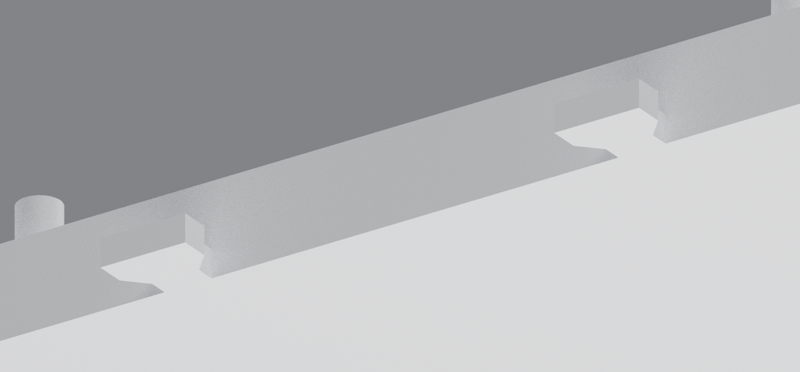
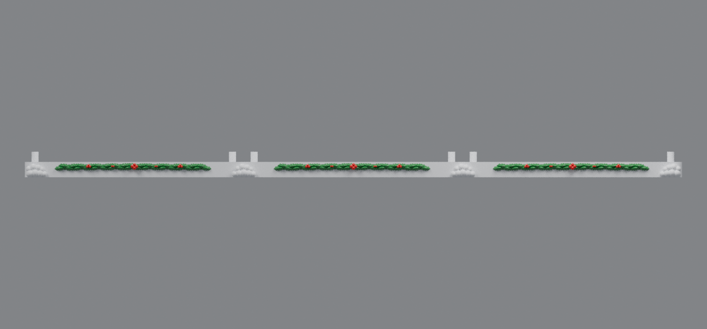

# Center-integrated base connectors (v6)

This is an earlier version. [Base v7](../base-customization-v7/README.md) retains the center-integrated connectors and corrects the mounting pegs to match the rev91 side housings and rev66 center housing.

V6 incorporates all four bow-tie connectors into the center snowy base. Two fixed tabs project from each side of the center plate and slide into the recessed pockets in the left and right plates. There is no separate connector STL to print or install.

The tabs overlap 9 mm into solid center-plate material and project 9 mm beyond each side. Each mating pocket provides 0.25 mm lateral clearance per side and 0.6 mm vertical clearance. The decorative snowball piles, clean front face, holly, mounting pins, and drawer clearance from v5 are retained.

## Downloads

- [Left snowy base v6](https://raw.githubusercontent.com/brucebentle-del/codex-workspace/refs/heads/main/base-customization-v6/left_snowy_base_v6.stl)
- [Center snowy base v6 with four fixed connector tabs](https://raw.githubusercontent.com/brucebentle-del/codex-workspace/refs/heads/main/base-customization-v6/center_snowy_base_v6.stl)
- [Right snowy base v6](https://raw.githubusercontent.com/brucebentle-del/codex-workspace/refs/heads/main/base-customization-v6/right_snowy_base_v6.stl)

Print each STL flat at 100% scale in millimeters. The left and right plates measure 172 × 185.58 × 20 mm. The center plate measures 190 × 185.58 × 20 mm including its tabs, so every part fits a 256 mm square printer bed.

## Assembly

1. Place the center base flat with its four fixed tabs accessible.
2. Align the two underside pockets of the left base with the two tabs on the center's left side.
3. Slide the left base horizontally toward the center until the decorated edges and split snowball pile meet.
4. Repeat for the right base.

Slide the outer bases onto the tabs from the sides. Do not press an outer base straight down onto the fixed tabs.

- [Illustrated assembly guide](assembly-guide.svg)

## Measurements and validation

- Integrated connectors: **4 total; 2 per side of center plate**
- Separate connector pieces to print: **0**
- Tab protrusion from center plate: **9 mm**
- Tab overlap into solid center material: **9 mm**
- Tab height: **3.6 mm**
- Pocket depth: **4.2 mm**
- Clearance: **0.25 mm laterally per side; 0.6 mm vertically**
- Assembled width: **516 mm**
- Snowball mound top: **10.527 mm**, below the 12 mm building-support plane

All three STLs are watertight, consistently wound, positive-volume meshes with one printable component. The assembled collision check found effectively zero interference at either joint, and the combined assembly resolves to one Boolean body. Protected mounting geometry matches `base_rev32.stl` within `1.21e-14 mm`.

See [validation-report.json](validation-report.json), [snow-placement.json](snow-placement.json), and [design-dimensions.json](design-dimensions.json) for machine-readable results.
