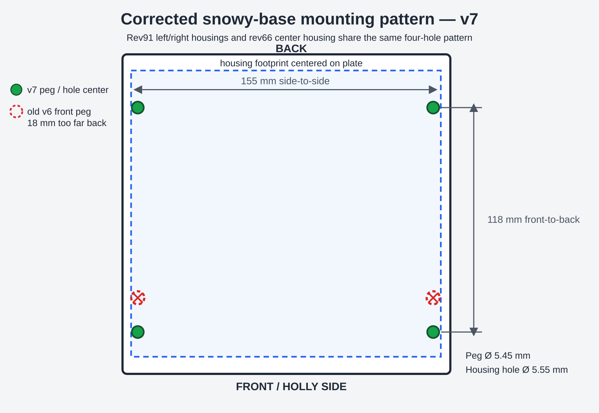
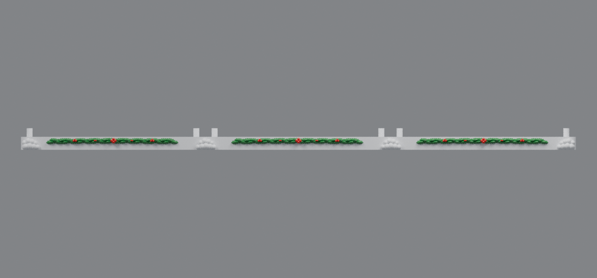

# Housing-matched mounting pegs (v7)

V7 corrects the front-to-back mounting pattern using the actual lower-housing meshes: rev91 for the left and right sections and rev66 for the center section. All three housings use holes at local Y=13 and Y=131, a center spacing of 118 mm. When each housing is centered on its 172 × 168 mm mounting plate, the corresponding snowy-base peg rows belong at Y=22 and Y=140.

V6 inherited rows at Y=40 and Y=140 from `base_rev32.stl`. Its front peg pair was therefore 18 mm too far back. V7 moves only that front pair. The side-to-side pattern, peg diameter, snow, holly, clean front face, mounting height, mating base pockets, and four center-integrated connector tabs are retained.

## Downloads

- [Left snowy base v7 for rev91 housing](https://raw.githubusercontent.com/brucebentle-del/codex-workspace/refs/heads/main/base-customization-v7/left_snowy_base_rev91_mount_v7.stl)
- [Center snowy base v7 for rev66 housing](https://raw.githubusercontent.com/brucebentle-del/codex-workspace/refs/heads/main/base-customization-v7/center_snowy_base_rev66_mount_v7.stl)
- [Right snowy base v7 for rev91 housing](https://raw.githubusercontent.com/brucebentle-del/codex-workspace/refs/heads/main/base-customization-v7/right_snowy_base_rev91_mount_v7.stl)

Print each STL flat at 100% scale in millimeters. Slide the left and right bases horizontally onto the center plate's fixed bow-tie tabs during assembly.

## Corrected mounting dimensions

- Peg centers: **X=8 and 163 mm; Y=22 and 140 mm**
- Side-to-side center spacing: **155 mm**
- Front-to-back center spacing: **118 mm**
- Peg diameter: **5.45 mm**
- Housing-hole diameter: approximately **5.55 mm**
- Minimum radial clearance measured from the supplied meshes: **0.049 mm**
- Housing placement on the mounting plate: **X=+11.5 mm; Y=+9 mm**
- Maximum peg-to-hole center error: **0.0007 mm**

## Validation

Each v7 base was checked against its corresponding supplied housing mesh. The corrected bases have effectively zero solid interference with the rev91 left, rev66 center, and rev91 right housings. The former v6 outer-base patterns produced approximately 186 mm³ of interference per side housing because the front pegs missed their holes.

All three v7 STLs are watertight, consistently wound, positive-volume meshes with one connected printable component. The two integrated base joints retain effectively zero interference and the assembled three-section base resolves to one Boolean body. The left and right plates measure 172 × 185.58 × 20 mm; the center measures 190 × 185.58 × 20 mm including its fixed connector tabs. Every section fits a 256 mm square printer bed.

See [validation-report.json](validation-report.json) and [build-report.json](build-report.json) for the measured source hashes, hole centers, clearances, and mesh checks.
