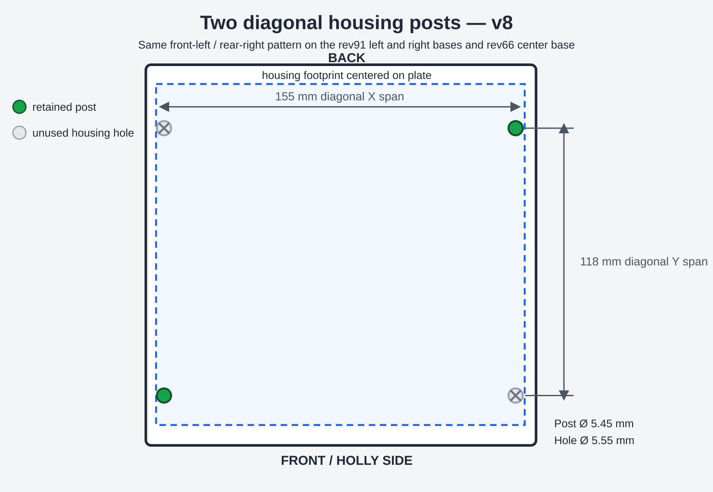
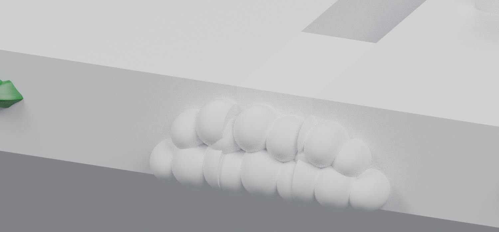
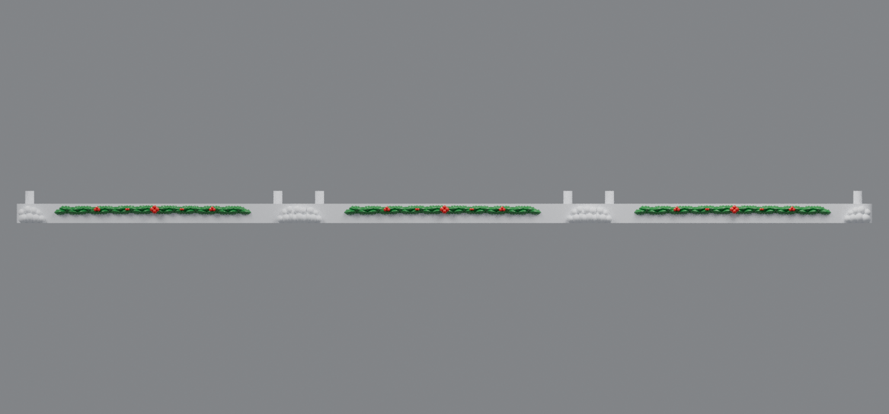

# Two diagonal posts and split snow-base extensions (v8)

V8 retains only two housing posts on each snowy base: the front-left post at X=8, Y=22 and the rear-right post at X=163, Y=140. These opposite-corner posts match the selected holes in the rev91 side housings and rev66 center housing while reducing the number of posts that can bind or break during assembly.

The original v7 bow-tie tabs and outer-base pockets are unchanged. Their measured symmetric geometry difference from v7 is 0.0 mm³ in all connector regions.

To close the visible opening between bases, each adjoining snowy edge extends 4.5 mm. The two extensions meet halfway across each 9 mm structural opening. The front plinth uses matching half extensions, and a rounded snowball mound is divided at the midpoint so the snow remains full and rounded across the seam.

## Downloads

- [Left snowy base v8 for rev91 housing](https://raw.githubusercontent.com/brucebentle-del/codex-workspace/refs/heads/main/base-customization-v8/left_snowy_base_rev91_two_posts_split_snow_extension_v8.stl)
- [Center snowy base v8 for rev66 housing](https://raw.githubusercontent.com/brucebentle-del/codex-workspace/refs/heads/main/base-customization-v8/center_snowy_base_rev66_two_posts_split_snow_extension_v8.stl)
- [Right snowy base v8 for rev91 housing](https://raw.githubusercontent.com/brucebentle-del/codex-workspace/refs/heads/main/base-customization-v8/right_snowy_base_rev91_two_posts_split_snow_extension_v8.stl)

Print each STL flat at 100% scale in millimeters.

## Mounting posts

- Posts per base: **2**
- Pattern: **front-left to rear-right diagonal**
- Centers: **X=8, Y=22 mm** and **X=163, Y=140 mm**
- Post diameter: **5.45 mm**
- Housing-hole diameter: approximately **5.55 mm**
- Maximum measured post-to-hole center error: **0.0007 mm**
- Housing interference: effectively **0 mm³** for all three sections

## Split snow-base extensions

- Structural opening between neighboring base plates: **9 mm**
- Visible extension on each adjoining snowy edge: **4.5 mm**
- Visible snow/plinth gap after assembly: **0 mm** at both joints
- Solid interference between extensions: effectively **0 mm³**
- Complete visible assembly width: **534 mm**
- Rounded snowball mounds added across the two closed seams: **2**

## Unchanged connectors

All three v8 STLs are watertight, consistently wound, positive-volume meshes with one connected printable component. The split visible extensions meet as one Boolean assembly. The outer bases measure 176.5 × 185.58 × 20 mm including their 4.5 mm snow extensions. The center remains within 190 × 185.58 × 20 mm because its original bow-tie tabs extend farther than its new snow edges. Every part fits a 256 mm square printer bed.

See [validation-report.json](validation-report.json) and [design-dimensions.json](design-dimensions.json) for the connector-preservation checks, seam bounds, housing fit measurements, source hashes, and mesh checks.
