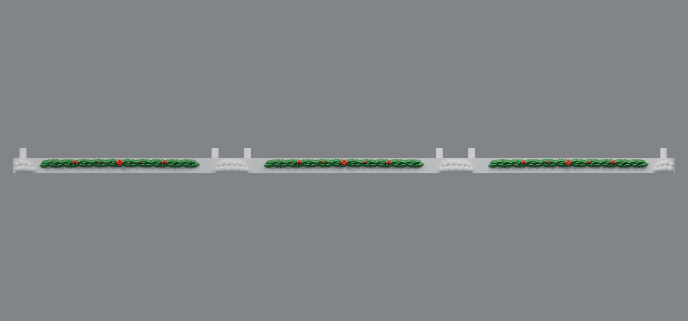
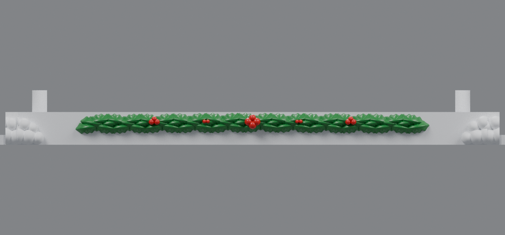

# Roof-width holly snowy bases (v9)

V9 makes the holly thicker and lusher on the left, center, and right snowy bases. Each base now uses three staggered, overlapping rows of domed leaves instead of two sparse rows.

The nominal leaf width is **5.55 mm**, matching the oversized holly used on the side roofs. Leaf count increased from **105 to 183** across the three bases. The highest leaf tip is **11.995 mm**, immediately below the **12 mm** building-support plane, so the fuller foliage remains clear of the drawers.

## Downloads

- [Left snowy base v9 for rev91 housing](https://raw.githubusercontent.com/brucebentle-del/codex-workspace/refs/heads/main/base-customization-v9/left_snowy_base_rev91_thick_roof_holly_v9.stl)
- [Center snowy base v9 for rev66 housing](https://raw.githubusercontent.com/brucebentle-del/codex-workspace/refs/heads/main/base-customization-v9/center_snowy_base_rev66_thick_roof_holly_v9.stl)
- [Right snowy base v9 for rev91 housing](https://raw.githubusercontent.com/brucebentle-del/codex-workspace/refs/heads/main/base-customization-v9/right_snowy_base_rev91_thick_roof_holly_v9.stl)

Print each STL flat at 100% scale in millimeters.

## Preserved fit and assembly geometry

- Two diagonal housing posts on every base at X/Y centers **(8, 22)** and **(163, 140) mm**
- Rev91 left and right housing fit and rev66 center housing fit retained
- Original center-integrated bow-tie tabs and outer-base pockets unchanged from v7
- Each visible snow edge still extends **4.5 mm** into its **9 mm** structural opening
- Visible gap remains **0 mm** at both assembled joints
- All three meshes are watertight, consistently wound, single-component solids
- All three parts fit a 256 mm square printer bed

See [validation-report.json](validation-report.json), [design-dimensions.json](design-dimensions.json), and [holly-placement.json](holly-placement.json) for measured fit, seam, mesh, and foliage details.
