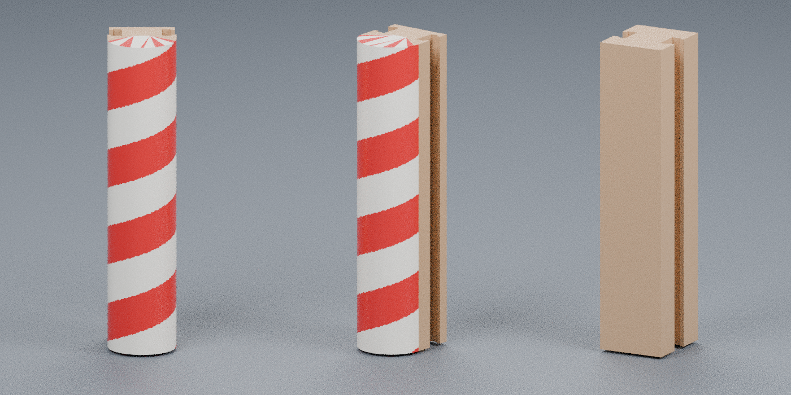

# Approved candy-cane connector color files (v1)

These 3MF files add the Candy-Cane Village reference colors to the approved **front rev85** and **rear rev86** connector geometry. Both connectors remain exactly 156.6 mm tall and retain their original fit surfaces.

## 3MF downloads

- [Front candy-cane connector rev85](https://raw.githubusercontent.com/brucebentle-del/codex-workspace/refs/heads/main/connector-color-v1/front_candy_cane_rev85_color_v1.3mf)
- [Flat rear connector rev86](https://raw.githubusercontent.com/brucebentle-del/codex-workspace/refs/heads/main/connector-color-v1/flat_rear_connector_rev86_champagne_v1.3mf)

Keep both models at 100% scale in millimeters. In Bambu Studio, map the listed materials to the corresponding AMS slots.

## Color mapping

### Front rev85

- **Candy Red Silk PLA** (`#D71920`): rounded candy-cane spiral and peppermint ends
- **White Silk PLA** (`#F7F5EE`): rounded candy-cane spiral and peppermint ends
- **Champagne Silk PLA** (`#C89A6B`): concealed attachment rail and tabs

The spiral uses a 39.15 mm pitch, producing four broad red/white wraps over the 156.6 mm height. The approved STL has flat ends, so their red/white peppermint pattern is supplied as 3MF color data without changing the end geometry.

### Rear rev86

- **Champagne Silk PLA** (`#C89A6B`): complete rear connector

## Approved source dimensions

| Connector | Source | Overall dimensions (X × Y × Z) |
|---|---|---:|
| Front | `front_candy_cane_rev85_156p6mm.stl` | 34.00 × 40.50 × 156.60 mm |
| Rear | `flat_rear_rev86_156p6mm.stl` | 34.00 × 38.775 × 156.60 mm |

## Geometry and validation

- Standard 3MF Core 1.0 archives with Materials Extension
- Original approved surfaces, bounds, and volumes retained
- Front sidewall triangulation refined on the same surface solely for cleaner face-level diagonal colors
- Both files reopen as watertight, consistently wound, positive-volume solids
- Source-to-3MF bounds error: **0 mm**
- Source-to-3MF volume difference: less than **0.000001 mm³**

See [3mf-validation-report.json](3mf-validation-report.json) for checksums, exact measurements, material counts, and archive checks.
