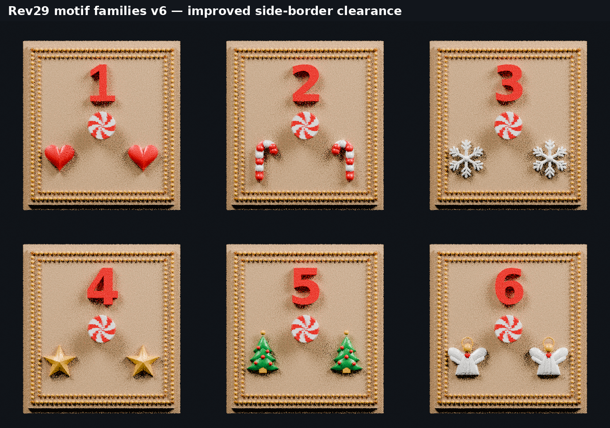

# Approved Rev29 drawers — reference-matched motifs color 3MF set v6

This set contains all 24 approved Rev29 drawers with newly modeled motif reliefs based on the Candy-Cane Village reference. The two rows of frame bumps remain Gold.

Every number uses drawer 1 as its size and position standard. Single digits share its height, depth, and center. Two-digit numbers use the same digit scale and are centered as a pair.

The new motif families are rounded pillow hearts, smooth hooked striped candy canes, double-branched snowflakes, beveled pillow stars, scalloped layered trees with red ornaments and Gold peak balls, and feather-winged angels with pleated White robes, Gold heads and halos, and Red heart details.

The small center peppermint has a finer curved six-sweep color pattern. Its approved surface and size are unchanged.

For safer visual clearance from the Gold frame, the hearts, snowflakes, stars, and trees are moved 1.5 mm inward on each side. The wider angels are moved 2.0 mm inward. The candy canes retain their prior positions because they already had ample clearance.

Corrected sequence: drawer 19 uses hearts and drawer 20 uses candy canes.

Material order is consistent in every file:

1. Champagne Silk PLA — drawer body and front field
2. White Silk PLA — peppermint/candy-cane white, snowflakes, and angels
3. Candy Red Silk PLA — raised number, hearts, and peppermint/candy-cane red
4. Candy Green Silk PLA — Christmas trees
5. Gold Silk PLA — double-beaded frame, stars, angel halos, and tree peak balls

The approved outer dimensions, drawer body, front field, and two-row frame remain unchanged. Raised number shells retain the drawer 1 normalization. The original simplified motifs were replaced with overlapping watertight printable relief parts that intersect the front field for secure attachment. Body facets were subdivided in place to improve the peppermint color pattern without changing the body surface. Import the 3MF directly into the slicer and confirm the five filament mappings before slicing.
