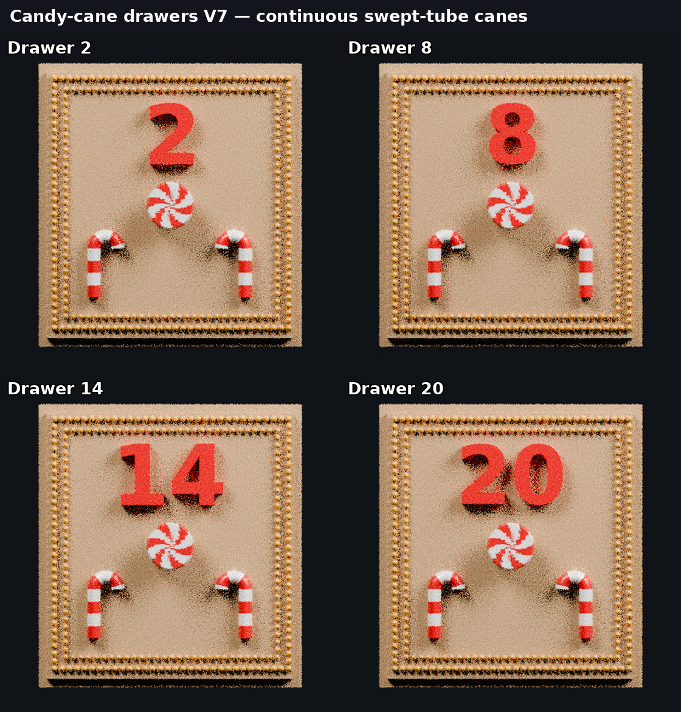
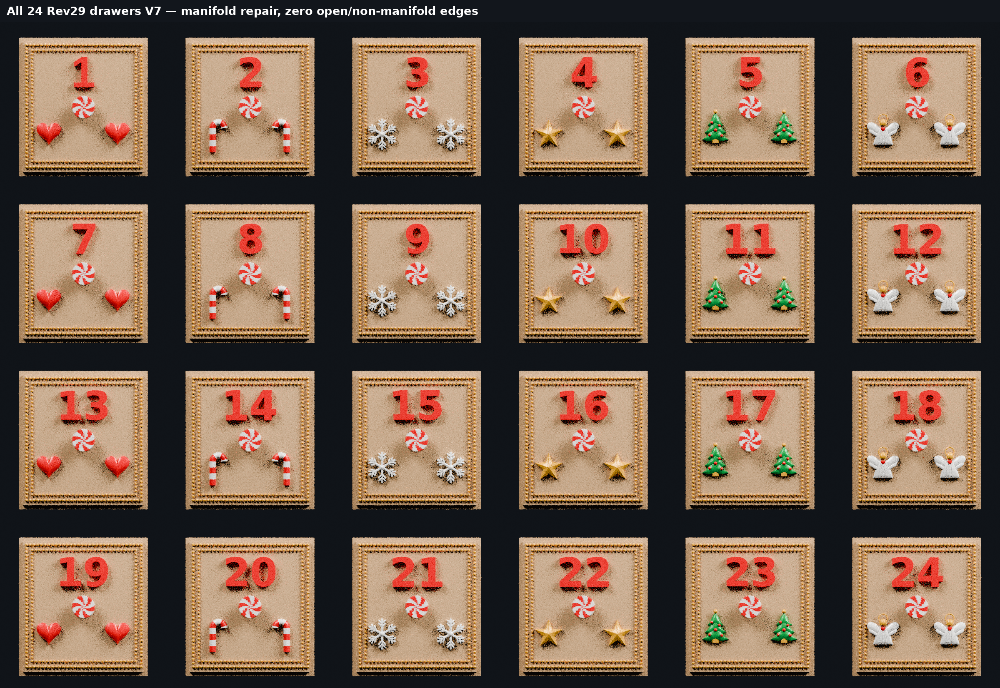

# Approved Rev29 drawers — manifold color 3MF set v7

This set repairs the topology warning reported on the V6 candy-cane drawers while preserving the approved drawer fit, number standard, motif layout, colors, and two Gold bead rows.

The V7 candy canes are each one continuous watertight swept tube. Red and White stripes are assigned directly to tube faces, eliminating the 72 intersecting capsule and bead shells used by V6. The original frame geometry is replaced with clean non-touching Gold beads, and any open number boundary is capped.

The reported Drawer 14 warning had two separate causes: the original bead frame produced 960 non-manifold edges, and the number 14 contained four open boundary edges. Both are repaired in V7. Drawer 20 also contained eight open number edges, so it was repaired at the same time.

Every reopened V7 file is required to have:

- zero open edges
- zero non-manifold edges
- consistent face winding
- a watertight edge topology
- unchanged approved outer bounds

Every number retains drawer 1's height, depth, and center standard. Two-digit numbers remain centered as a pair. Drawer 19 uses hearts and drawer 20 uses candy canes.

## Candy-cane drawer validation

| Drawer | Final triangles | Open edges | Non-manifold edges | Watertight | Consistent winding |
| ---: | ---: | ---: | ---: | :---: | :---: |
| 2 | 115,956 | 0 | 0 | Yes | Yes |
| 8 | 116,112 | 0 | 0 | Yes | Yes |
| 14 | 115,694 | 0 | 0 | Yes | Yes |
| 20 | 116,070 | 0 | 0 | Yes | Yes |

The same checks pass for all 24 drawers. See `topology-validation-summary-v7.json` for the compact result and `3mf-validation-report.json` for the full per-file audit.

Material order is consistent in every file:

1. Champagne Silk PLA — drawer body and front field
2. White Silk PLA — peppermint/candy-cane white, snowflakes, and angels
3. Candy Red Silk PLA — raised number, hearts, and peppermint/candy-cane red
4. Candy Green Silk PLA — Christmas trees
5. Gold Silk PLA — double-beaded frame, stars, angel halos, and tree peak balls

Import the 3MF directly into the slicer and confirm the five filament mappings before slicing.

## Previews

