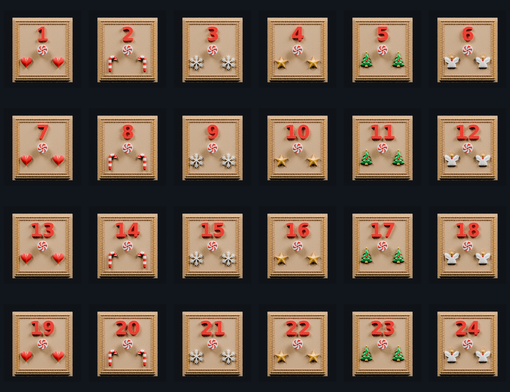

# Approved Rev29 drawers — peppermint-disc knob color 3MF set v8

This set keeps the V7 topology repairs and replaces the coplanar knob coloring with a printable peppermint-candy disc.

Every drawer now has a classic peppermint-disc knob: six broad curved Candy Red sectors alternate with six White sectors and taper into a small center button. The red sectors project only 0.435 mm beyond the approved knob face and overlap the knob by 0.185 mm, giving the slicer a clear physical color boundary while preserving the candy-disc appearance.

The candy canes remain continuous watertight swept tubes. The clean non-touching Gold bead frame and repaired number boundaries are also retained.

Every reopened V8 file is required to have:

- zero open edges
- zero non-manifold edges
- consistent face winding
- a watertight edge topology
- unchanged X/Z fit bounds and rear bound
- only a 0.435 mm front extension at the peppermint knob relief

Every number retains drawer 1's height, depth, and center standard. Two-digit numbers remain centered as a pair. Drawer 19 uses hearts and drawer 20 uses candy canes.

Material order is consistent in every file:

1. Champagne Silk PLA — drawer body and front field
2. White Silk PLA — peppermint/candy-cane white, snowflakes, and angels
3. Candy Red Silk PLA — raised number, hearts, and peppermint/candy-cane red
4. Candy Green Silk PLA — Christmas trees
5. Gold Silk PLA — double-beaded frame, stars, angel halos, and tree peak balls

Import the 3MF directly into the slicer and confirm the five filament mappings before slicing.

## Previews

