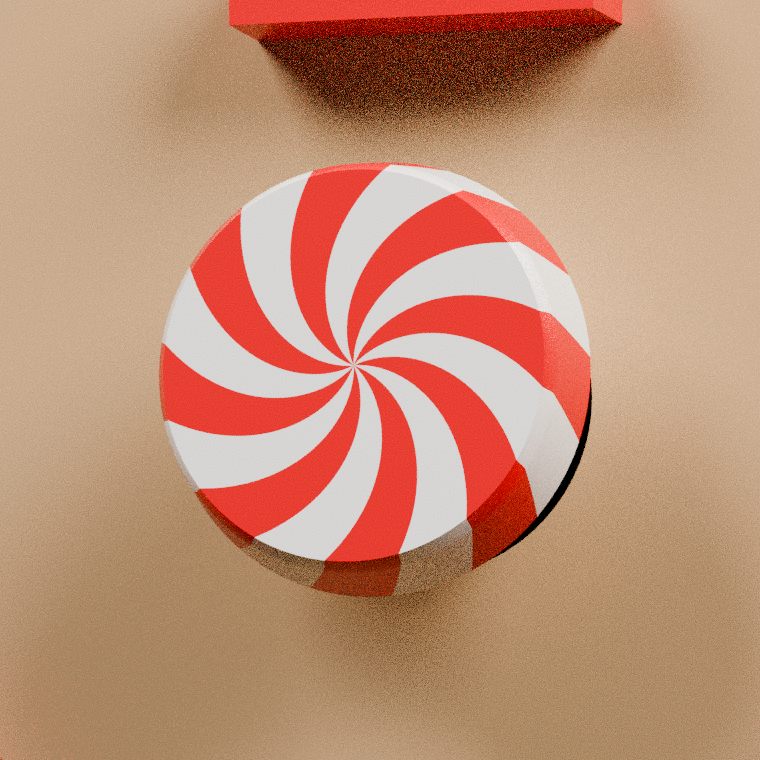
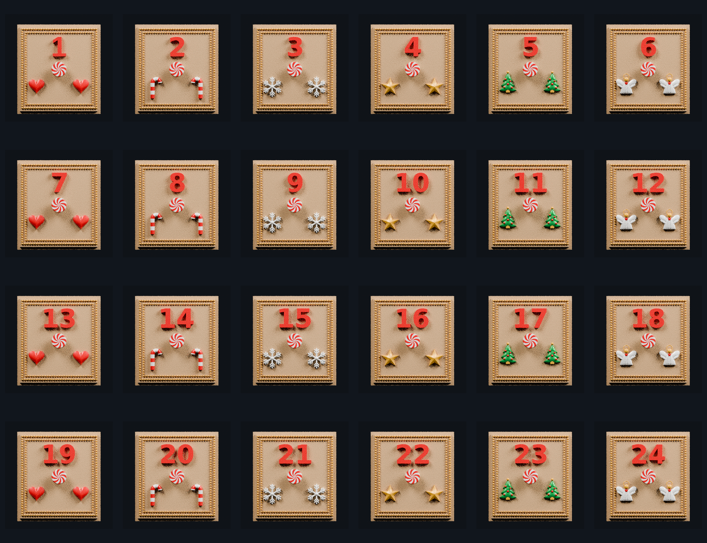

# Approved Rev29 drawers — reference-style wrapped peppermint knobs v9

This set keeps the V7 topology repairs and rebuilds every drawer knob to resemble the rounded peppermint candies in the user's reference.

Every drawer now has eight broad curved Candy Red sectors alternating with eight White sectors. The sectors taper into the center, extend fully to the perimeter without a white stopping border, then continue over the rounded edge to the lower rim of the knob.

The complete Red-and-White candy surface is one continuous closed cap. Both colors are flush on the same surface, with shared edges and no spaces between them. The cap stands only 0.200 mm above the approved front and overlaps it by 0.120 mm. Along the rounded rim it tapers to 0.120 mm above the surface and overlaps by 0.060 mm.

The candy canes remain continuous watertight swept tubes. The clean non-touching Gold bead frame and repaired number boundaries are also retained.

Every reopened V9 file is required to have:

- zero open edges
- zero non-manifold edges
- consistent face winding
- a watertight edge topology
- unchanged X/Z fit bounds and rear bound
- only a 0.200 mm front extension at the peppermint knob relief

Every number retains drawer 1's height, depth, and center standard. Two-digit numbers remain centered as a pair. Drawer 19 uses hearts and drawer 20 uses candy canes.

Material order is consistent in every file:

1. Champagne Silk PLA — drawer body and front field
2. White Silk PLA — peppermint/candy-cane white, snowflakes, and angels
3. Candy Red Silk PLA — raised number, hearts, and peppermint/candy-cane red
4. Candy Green Silk PLA — Christmas trees
5. Gold Silk PLA — double-beaded frame, stars, angel halos, and tree peak balls

Import the 3MF directly into the slicer and confirm the five filament mappings before slicing.

## Previews

