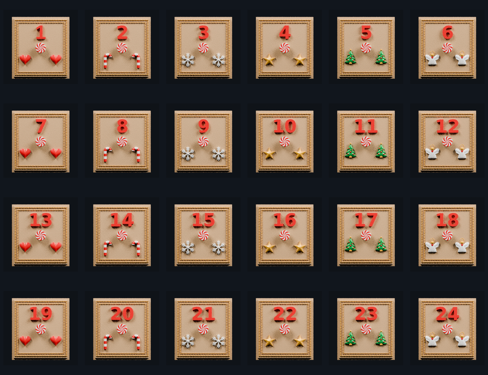

# Rev29 drawers — wrapped peppermint V9 STL set

This folder contains one combined binary STL for each of the 24 finalized V9 drawers.

The STL models preserve the complete printable geometry from the approved V9 3MF set, including:

- the flush, gap-free peppermint knob cap
- eight Red-pattern sectors and eight White-pattern sectors as physical surface geometry
- the pattern wrapped across the rounded knob rim
- the approved drawer body, numbers, motifs, and double-beaded frame
- the manifold repairs introduced in V7

## Important color limitation

STL does not store filament or material assignments. Each STL therefore imports as a single-color model. Use the V9 3MF files when the slicer must automatically retain the Champagne, White, Candy Red, Candy Green, and Gold assignments.

## Validation

All 24 exported STLs were reopened and checked for:

- zero open edges
- zero non-manifold edges
- watertight geometry
- consistent face winding
- unchanged model bounds within 0.0001 mm
- volume round-trip error below 0.01 mm³

See `stl-validation-report-v9.json` for the per-file dimensions, triangle counts, hashes, and topology results.

## Previews

