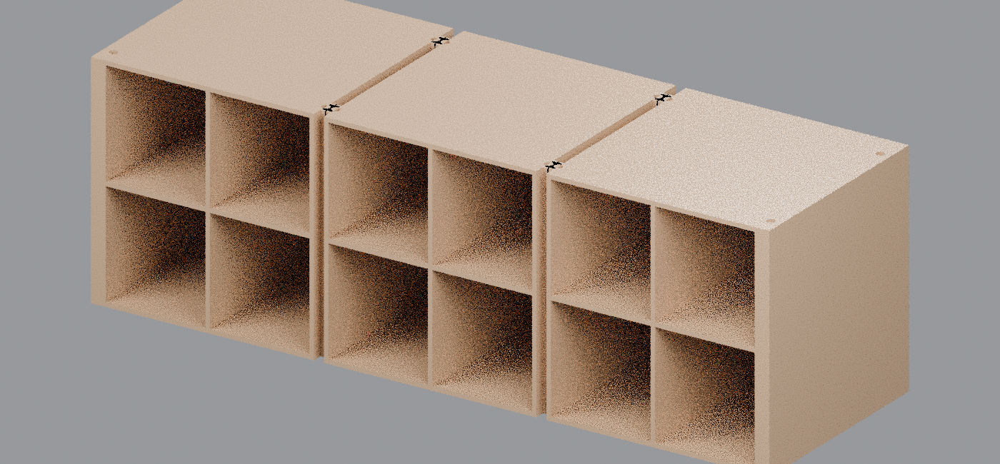

# Champagne-color lower housings (v1)

These 3MF files convert the verified lower-housing STLs to the color shown in the Candy-Cane Village reference. The cabinet body, shelves, walls, rails, and mounting features are assigned **Champagne Silk PLA** (`#C89A6B`).

The candy-cane columns shown between the cottages in the reference are separate connector models. They are not contained in these housing STLs, so no red or white material is assigned here.

## 3MF downloads

- [Left lower housing rev91](https://raw.githubusercontent.com/brucebentle-del/codex-workspace/refs/heads/main/housing-color-v1/left_lower_housing_rev91_champagne_v1.3mf)
- [Center lower housing rev66](https://raw.githubusercontent.com/brucebentle-del/codex-workspace/refs/heads/main/housing-color-v1/center_lower_housing_rev66_champagne_v1.3mf)
- [Right lower housing rev91](https://raw.githubusercontent.com/brucebentle-del/codex-workspace/refs/heads/main/housing-color-v1/right_lower_housing_rev91_champagne_v1.3mf)

In Bambu Studio, map **Champagne Silk PLA** to the intended AMS slot. Keep every model at 100% scale in millimeters.

## Source mapping and dimensions

| Housing | Source revision | Overall dimensions (X × Y × Z) |
|---|---:|---:|
| Left | rev91 | 162.25 × 150.50 × 157.10 mm |
| Center | rev66 | 162.00 × 150.50 × 157.10 mm |
| Right | rev91 | 162.25 × 150.50 × 157.10 mm |

## Validation

- Standard 3MF Core 1.0 archive with Materials Extension
- One explicit Champagne Silk PLA assignment on every triangle
- All three files reopen as watertight, consistently wound, positive-volume solids
- Source-to-3MF bounds error: **0 mm**
- Source-to-3MF volume error: **0 mm³**

See [3mf-validation-report.json](3mf-validation-report.json) for checksums, exact bounds, volumes, and archive checks.
