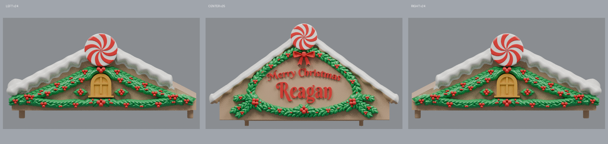

# Approved roof color 3MF files (v1)

These 3MF files apply the Candy-Cane Village reference palette to the approved **left v24**, **center rev31 v25**, and **right v24** roofs. The approved roof geometry, mounting surfaces, dimensions, and strengthening repairs are unchanged.

## 3MF downloads

- [Left roof v24](https://raw.githubusercontent.com/brucebentle-del/codex-workspace/refs/heads/main/roof-color-v1/left_roof_v24_color_v1.3mf)
- [Center roof rev31 v25](https://raw.githubusercontent.com/brucebentle-del/codex-workspace/refs/heads/main/roof-color-v1/center_roof_rev31_v25_color_v1.3mf)
- [Right roof v24](https://raw.githubusercontent.com/brucebentle-del/codex-workspace/refs/heads/main/roof-color-v1/right_roof_v24_color_v1.3mf)

Keep every model at 100% scale in millimeters. In Bambu Studio, map each listed material to the corresponding AMS slot before slicing.

## Reference color mapping

- **Champagne Silk PLA** (`#C89A6B`): roof, facade, and center sign field
- **White Silk PLA** (`#F7F5EE`): snow and white peppermint sectors
- **Candy Red Silk PLA** (`#D71920`): berries, bow, lettering, and red peppermint sectors
- **Candy Green Silk PLA** (`#007A33`): holly leaves and concealed holly backing
- **Gold Silk PLA** (`#D89A18`): left and right window details

The left and right roofs use all five colors. The center uses champagne, white, red, and green; it contains no gold window.

## Approved source geometry

| Roof | Source revision | Overall dimensions (X × Y × Z) | Triangles |
|---|---|---:|---:|
| Left | v24 | 166.907 × 173.958 × 75.914 mm | 1,007,830 |
| Center | rev31 v25 | 244.687 × 180.747 × 134.524 mm | 1,789,884 |
| Right | v24 | 166.907 × 173.958 × 75.914 mm | 1,007,830 |

## Geometry and validation

- Standard 3MF Core 1.0 archives with Materials Extension
- One watertight printable object per file
- Explicit material assignment on every triangle
- Left and right assignments come directly from the final approved v24 semantic build data
- Center assignments retain the approved v12 paint regions on the v25 strengthened geometry; the reinforced ribbon tails are red, the holly backing is green, and the raised roof snow is white
- All three files reopen as watertight, consistently wound, positive-volume solids
- Source-to-3MF bounds error: **0 mm**
- Source-to-3MF volume error: **0 mm³**

See [3mf-validation-report.json](3mf-validation-report.json) for checksums, exact bounds, volumes, material counts, and archive checks.
