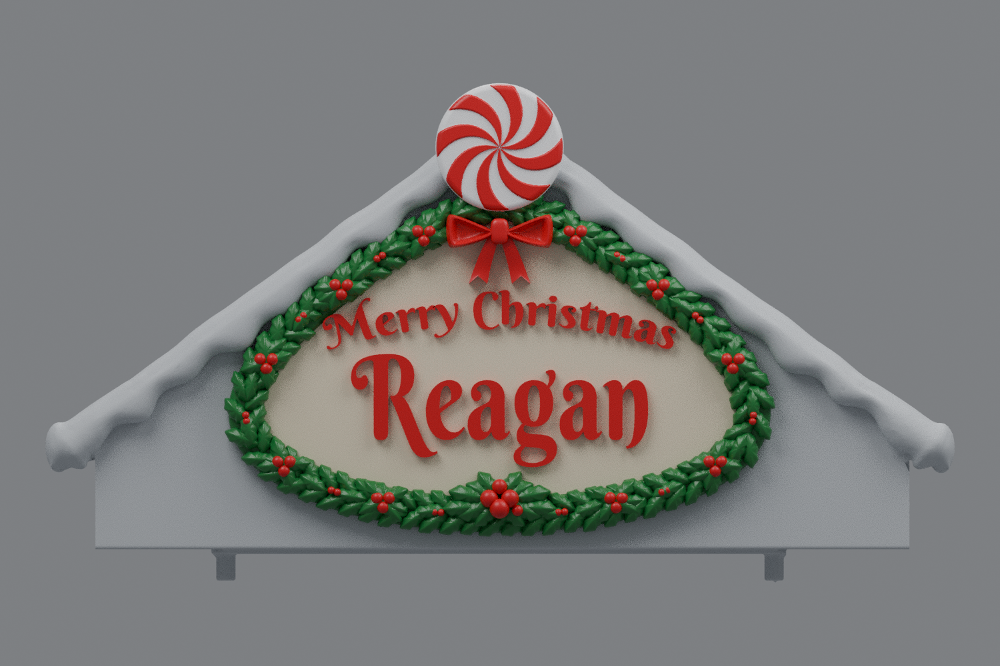

# Center rev31 — lowered peppermint, two-row holly, folded bow, and raised lettering (v10)

This is an earlier version. The current [rev31 v11](../roof-customization-v11/README.md) adjusts the lettering spacing, adds mirrored side holly clusters, and projects the bow another 2 mm outward.

The peppermint is lowered so the structural gable peak meets the center of the disc. The holly now has two full overlapping rows, a thicker backing, and a prominent bottom-center leaf-and-berry cluster. The bow has broad folded ribbon loops, a rectangular knot, and fishtail ends. The lettering is raised an additional 1 mm from the sign face.

## Download

[Download the fused rev31 STL](https://github.com/brucebentle-del/codex-workspace/raw/refs/heads/main/roof-customization-v10/center_roof_rev31_lower_peppermint_double_holly_v10.stl)

This is one fused, watertight part. The left and right roofs remain at v4: [left](../roof-customization-v4/left_roof_rev10_inner_snow_flat_scalloped_snow_v4.stl), [right](../roof-customization-v4/right_roof_rev10_inner_snow_flat_mirrored_scalloped_snow_v4.stl). Rev31 is the only center version in current downloads.

## Previews

These renders use the exported mesh. Colors are a painting guide; the STL contains geometry without colors.

- [Holly, bow, and lettering close-up](sign-paint-guide-v10.png)
- [Unpainted oblique view showing the raised relief](sign-solid-v10.png)

## Changes and dimensions

The peppermint retains its 34.5 mm diameter and eight raised swirls. Its center moves down approximately 12.22 mm to the intersection of the two structural roof planes, at X=73.931, Z=109.638. Its attachment is fused into the existing snow. The saved mesh's center alignment is checked in [surface-validation.json](surface-validation.json); construction dimensions are in [peppermint-dimensions.json](peppermint-dimensions.json).

The garland contains 207 rounded, domed leaves, including two complete staggered rows and additional overlapping clusters. Its backing is 8.6–9.6 mm wide and 4.5 mm deep. The green relief uses approximately three times the material of v9 before fusion to the facade. The lower center has a 12-leaf rosette and five larger berries, with the largest berry approximately 5.36 mm across.

The bow is approximately 28.74 mm wide and 18.64 mm high. Its broad loop faces have recessed folds and rounded raised rims, with a rectangular knot and 14 mm tails ending in 5 mm wide fishtails.

The existing wording, font, and lettering positions are retained. Lettering projects 2 mm above the sign face, increased from 1 mm. This change raises the relief outward from the facade; it does not move the words upward. Full measurements are in [sign-dimensions.json](sign-dimensions.json). All dimensions assume the original millimeter import scale.

## Validation

The saved STL reloads as watertight, with consistent winding, positive volume, and one connected material part. Hash, bounds, and construction measurements are in [mesh-validation.json](mesh-validation.json).

Saved-file surface checks compare original mounting surfaces and the functional underside within 0.01 mm; retained snow outside the new disc and bow attachments, raised lettering, and the translated peppermint face within 0.02 mm; and exposed roof planes within 0.005 mm. The disc diameter and center alignment are measured from the saved mesh. Results are in [surface-validation.json](surface-validation.json).

The checked v9 bare gable is reused before adding the new decoration, preserving the earlier removal of all visible old holly remnants. Its cleanup results and input hash are in [holly-cleanup-validation.json](holly-cleanup-validation.json).

Lettering uses Berkshire Swash by Brian J. Bonislawsky / Astigmatic under the [SIL Open Font License](BerkshireSwash-OFL.txt). Physical printing and assembly have not been tested.
