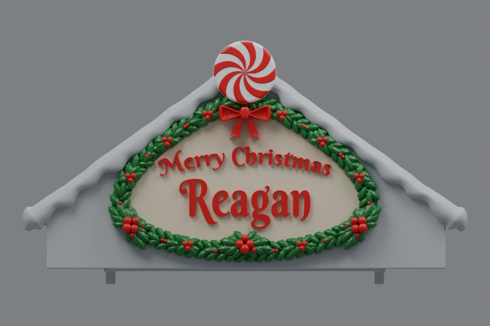

# Center rev31 — spaced lettering, mirrored side holly, and deeper bow (v11)

This is an earlier version. The current [rev31 v12](../roof-customization-v12/README.md) adds rear peppermint swirls and matched outer holly extensions.

“Reagan” is 10% smaller and remains larger than “Merry Christmas.” The greeting is lowered 2.5 mm to give it more room below the bow. Full-size copies of the bottom-center holly cluster fill the marked left and right areas, mirrored to each other. The bow projects another 2 mm outward at its existing height.

## Download

[Download the fused rev31 STL](https://github.com/brucebentle-del/codex-workspace/raw/refs/heads/main/roof-customization-v11/center_roof_rev31_spaced_lettering_side_holly_v11.stl)

This is one fused, watertight part. The left and right roofs remain at v4: [left](../roof-customization-v4/left_roof_rev10_inner_snow_flat_scalloped_snow_v4.stl), [right](../roof-customization-v4/right_roof_rev10_inner_snow_flat_mirrored_scalloped_snow_v4.stl). Rev31 is the only center version in current downloads.

## Previews

These renders use the exported mesh. Colors are a painting guide; the STL contains geometry without colors.

- [Lettering and holly close-up](sign-paint-guide-v11.png)
- [Unpainted oblique view showing the outward bow relief](sign-solid-v11.png)

## Changes and dimensions

The name is scaled uniformly to 90% in the facade plane, centered on its original lower edge. Its width changes from 80 to 72 mm; its overall height is approximately 27.47 mm. The greeting keeps its font size and moves down 2.5 mm. Both retain 2 mm of raised relief above the sign face. The spelling remains “Reagan.” Bounds and placement details are in [lettering-layout.json](lettering-layout.json).

Each new side accent copies the original bottom-center rosette: 12 leaves and five berries at full size. The left copy is centered at X=10.5, Z=25 and rotated −50 degrees to follow the border. The right copy reflects it across the gable center plane, X=73.931. Buried roots join the outer leaves to the facade. The original two-row garland and bottom-center rosette are retained. Placement and bounds are in [side-cluster-dimensions.json](side-cluster-dimensions.json).

All visible bow surfaces, including the loops, knot, and tails, move outward by 2 mm. The buried back planes stay attached to the sign, and every horizontal and vertical bow coordinate is unchanged. Measurements are in [bow-placement-validation.json](bow-placement-validation.json).

The 34.5 mm peppermint remains centered on the structural gable peak. Roof structure, mounting geometry, snow, and the existing sign field are retained. General measurements are in [sign-dimensions.json](sign-dimensions.json) and [peppermint-dimensions.json](peppermint-dimensions.json). Dimensions assume the original millimeter import scale.

## Validation

The saved STL reloads as watertight, with consistent winding, positive volume, and one connected material part. Hash, bounds, and construction measurements are in [mesh-validation.json](mesh-validation.json).

Saved-file checks compare original mounting surfaces and the functional underside within 0.01 mm; retained snow, updated lettering, peppermint face, mirrored berry clusters, and the projected bow within 0.02 mm; and exposed roof planes within 0.005 mm. The disc diameter and center alignment are also measured. Results are in [surface-validation.json](surface-validation.json).

The checked bare gable preserves the earlier removal of old holly remnants. Cleanup results and the input hash are in [holly-cleanup-validation.json](holly-cleanup-validation.json).

Lettering uses Berkshire Swash by Brian J. Bonislawsky / Astigmatic under the [SIL Open Font License](BerkshireSwash-OFL.txt). Physical printing and assembly have not been tested.
