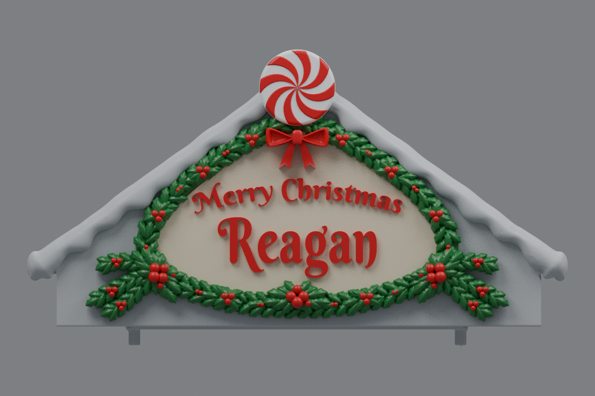

# Center rev31 — rear peppermint swirls and mirrored outer holly (v12)

This is an earlier version. The current [rev31 v25](../roof-customization-v25/README.md) reinforces the two hanging ribbon tails and connects the holly to the facade after the v12 test print.

The peppermint now has raised swirls on both faces. New holly fans extend outward and downward into the marked bare areas beside the lower corner clusters. The complete left extension is mirrored for the right side, including every leaf, stem, and berry.

## Download

[Download the fused rev31 STL](https://github.com/brucebentle-del/codex-workspace/raw/refs/heads/main/roof-customization-v12/center_roof_rev31_double_sided_peppermint_extended_holly_v12.stl)

This is one fused, watertight part. The left and right roofs remain at v4: [left](../roof-customization-v4/left_roof_rev10_inner_snow_flat_scalloped_snow_v4.stl), [right](../roof-customization-v4/right_roof_rev10_inner_snow_flat_mirrored_scalloped_snow_v4.stl). Rev31 is the only center version in current downloads.

## Previews

These renders use the exported mesh. Colors are a painting guide; the STL contains geometry without colors.

- [Extended holly close-up](sign-paint-guide-v12.png)
- [Unpainted oblique view](sign-solid-v12.png)
- [Rear peppermint view](rear-peppermint-paint-guide-v12.png)

The roof obscures the lower part of the disc from directly behind. The rear preview shows the exposed patterned area above and beside the snow.

## Changes and dimensions

The peppermint retains its 34.5 mm diameter, position at the gable peak, and original front relief. The rear face has eight curved swirls raised 0.4875 mm, matching the front relief height. The pattern is mirrored in the disc plane so it has the same visible swirl handedness from the back. The rear rim and new concentric face form a closed mesh. Dimensions are in [rear-swirl-dimensions.json](rear-swirl-dimensions.json) and [peppermint-dimensions.json](peppermint-dimensions.json).

Each holly extension has three stems, 35 leaves, and nine berries. The left fan reaches approximately X=−21.92 to 10.56 and Z=3.50 to 35.07 mm. The right fan is its exact reflection about X=73.931. The stems are rooted into the facade, with a lower margin above the base and mounting features. Source bounds, equal volumes, and zero mirror-coordinate error are recorded in [holly-extension-dimensions.json](holly-extension-dimensions.json).

The v11 lettering layout, 2 mm lettering relief, outward bow projection, original two-row garland, bottom rosette, corner clusters, roof structure, and snow are retained. General measurements are in [sign-dimensions.json](sign-dimensions.json), [lettering-layout.json](lettering-layout.json), and [bow-placement-validation.json](bow-placement-validation.json). Dimensions assume the original millimeter import scale.

## Validation

The saved STL reloads as watertight, with consistent winding, positive volume, and one connected material part. Hash, bounds, and construction measurements are in [mesh-validation.json](mesh-validation.json).

Saved-file checks compare original mounting surfaces and the functional underside within 0.01 mm; retained snow, lettering, peppermint front, corner clusters, bow, outer holly fans, and exposed rear swirls within 0.02 mm; and exposed roof planes within 0.005 mm. Disc diameter and center alignment are measured from the saved mesh. Results are in [surface-validation.json](surface-validation.json).

All eight rear swirl peaks and valleys are ray-checked on the closed candy component. Exposed rear-face points above the roof are separately compared against the saved fused STL. Results are in [rear-pattern-validation.json](rear-pattern-validation.json). The front construction vertices remain unchanged.

The checked bare gable preserves the earlier removal of old holly remnants. Cleanup results and the input hash are in [holly-cleanup-validation.json](holly-cleanup-validation.json). Lettering uses Berkshire Swash by Brian J. Bonislawsky / Astigmatic under the [SIL Open Font License](BerkshireSwash-OFL.txt). Physical printing and assembly have not been tested.
