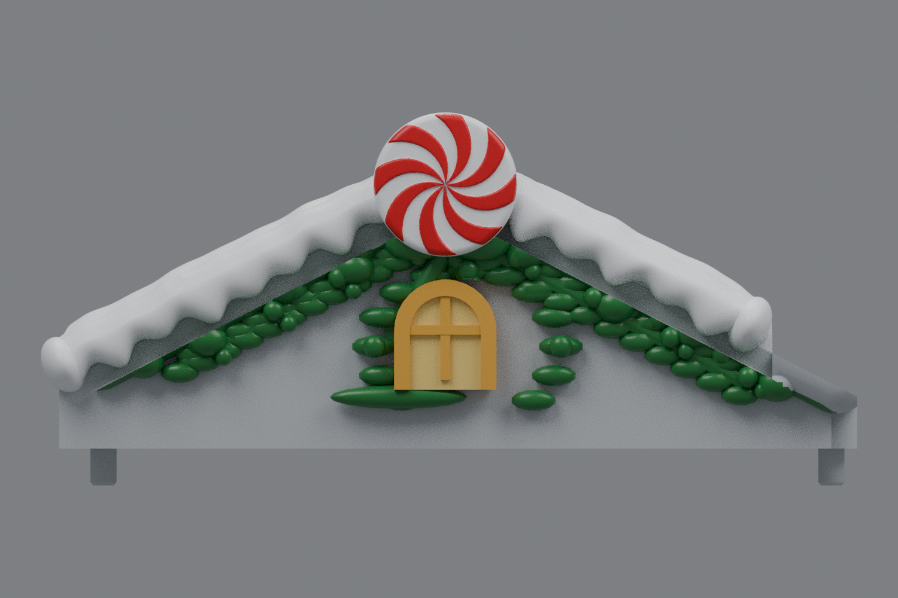
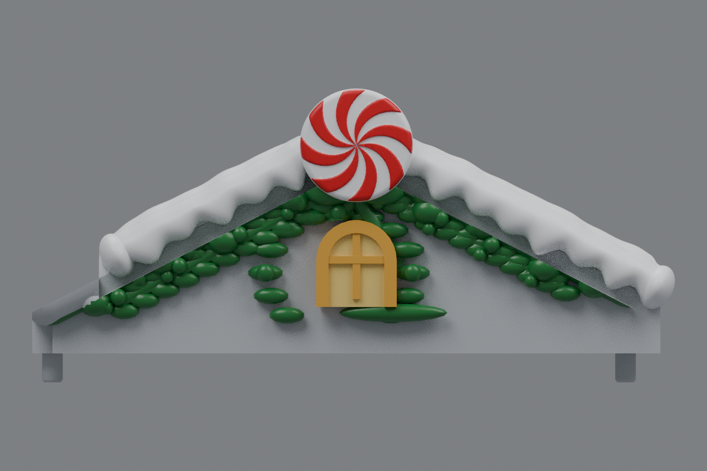

# Left and right roofs — rounded snow, matching peppermint, centered windows (v13)

The current side roofs are [v17](../roof-customization-v17/README.md), with thicker lower holly and two added rows spanning the full bottom garland.

These side roofs use rounded, scalloped snow in the center roof's style, matching two-sided peppermint discs, and windows centered on their gable peaks. The rounded inner snow ends stop short to preserve the original landing areas for the center roof. No new holly is added at the tips. The complete right model mirrors the left using the verified original transform.

The center remains **rev31 v12**, unchanged and pending your test print.

## Downloads

- [Download left roof STL](https://github.com/brucebentle-del/codex-workspace/raw/refs/heads/main/roof-customization-v13/left_roof_rev10_center_style_snow_peppermint_v13.stl)
- [Download right roof STL](https://github.com/brucebentle-del/codex-workspace/raw/refs/heads/main/roof-customization-v13/right_roof_rev10_center_style_snow_peppermint_v13.stl)
- [Unchanged center rev31 v12 STL](https://github.com/brucebentle-del/codex-workspace/raw/refs/heads/main/roof-customization-v12/center_roof_rev31_double_sided_peppermint_extended_holly_v12.stl)

Each roof is one fused, watertight part. Preserve the original import units and orientation; dimensions below assume millimeters.

## Previews

Colors are painting guides; the STL files contain geometry without colors. These views use the exported meshes.

| Left roof | Right roof |
| --- | --- |
| [Front](left-front-v13.png) | [Front](right-front-v13.png) |
| [Top](left-top-v13.png) | [Top](right-top-v13.png) |
| [Inner end and landing](left-inner-v13.png) | [Inner end and landing](right-inner-v13.png) |

## Geometry

The snow has a softly domed front section, rounded front tips, scalloped roof-facing edges, and smooth feet at the ridge and outer eave. The inner landing is restored from the original rev10 source: the left snow stops before X=136, with the mirrored right stop at X=12. The shortened ends have a rounded snow-only finish.

The peppermint copies the center's eight curved swirls on both faces and rounded rim at 85% scale: 29.325 mm across, with approximately 0.414 mm relief on each face. Its center aligns with the structural gable peak. As on the center roof, the roof masks part of the disc from behind.

The original window unit, including its arch, panes, and mullions, is translated approximately 4.5 mm to the gable center. Its original size and vertical placement are retained. The left center is X=69.500 and the right center X=78.500. Detailed design dimensions are in [side-design-dimensions.json](side-design-dimensions.json).

## Validation

Both saved STLs reload as watertight, consistently wound, positive-volume solids with one connected material part. [mesh-validation.json](mesh-validation.json) records hashes, bounds, triangle counts, numerical cleanup, and mirror measurements. The original uploaded right roof is a verified reflection of the left, as recorded in [original-right-source-match.json](original-right-source-match.json).

Saved-file checks compare original mounting and underside surfaces and the inner landing within 0.01 mm, the moved window front within 0.02 mm, and bare roof probes within 0.005 mm. The windows' centers and disc dimensions are measured from the saved meshes. A solid-volume check limits newly added material in the protected inner roof landing to 0.03 cubic mm. Results are in [surface-validation.json](surface-validation.json).

All eight peaks and valleys on both faces of the scaled candy component are ray-checked in [peppermint-pattern-validation.json](peppermint-pattern-validation.json). The center v12 hash is checked unchanged.

Physical printing and assembled clearance still require a test print. The original mounting geometry and inner landing provide the reference for these digital checks.
