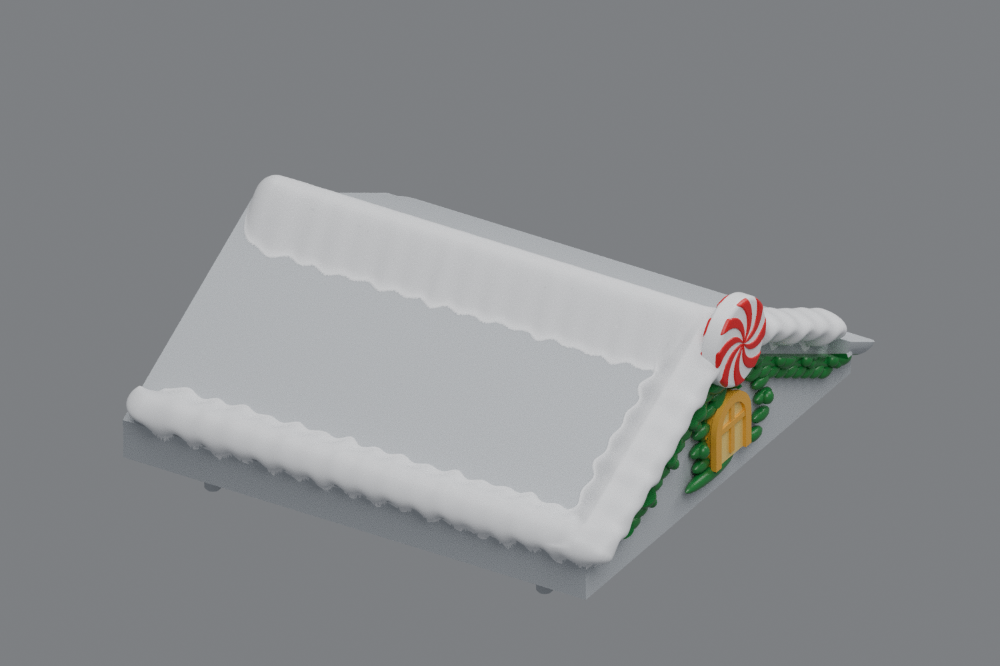
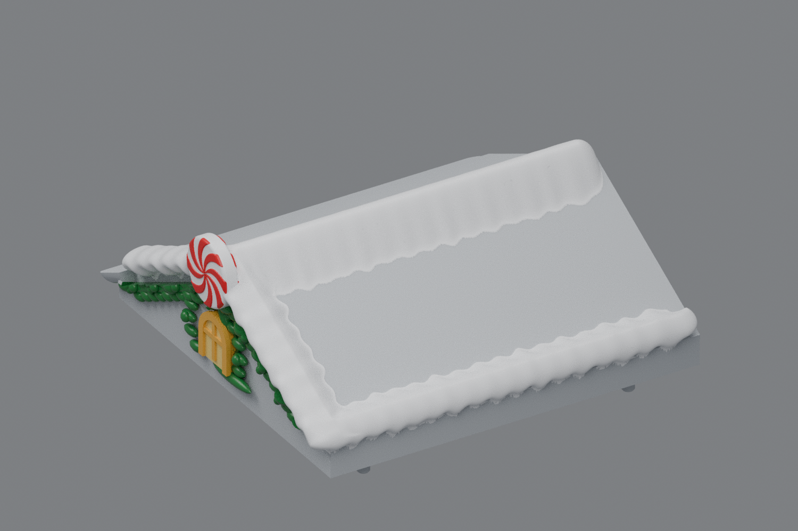

# Side roofs — scalloped side snow and smooth joins (v14)

The current side roofs are [v19](../roof-customization-v19/README.md), with a filled top holly gap, a larger bottom-center cluster and less upper drape.

The exposed long side drifts now have rounded lower scallops like the front. The front, outer eave, and ridge snow form one continuous surface, with rounded corner ends and smoothly tapered roof-facing edges. The recessed strips and remnants beneath the old snow footprint are removed.

The left and right roofs mirror each other. Their shortened inner snow tips retain a rounded **snow-only** finish and preserve the original landing areas for the center roof. The centered windows and two-sided peppermint discs from v13 are retained. Center **rev31 v12 is unchanged**, pending your test print.

## Downloads

- [Left roof STL](https://github.com/brucebentle-del/codex-workspace/raw/refs/heads/main/roof-customization-v14/left_roof_rev10_center_style_snow_peppermint_v14.stl)
- [Right roof STL](https://github.com/brucebentle-del/codex-workspace/raw/refs/heads/main/roof-customization-v14/right_roof_rev10_center_style_snow_peppermint_v14.stl)
- [Unchanged center rev31 v12 STL](https://github.com/brucebentle-del/codex-workspace/raw/refs/heads/main/roof-customization-v12/center_roof_rev31_double_sided_peppermint_extended_holly_v12.stl)

Each STL contains one fused, watertight material part. Keep the original import units and orientation; dimensions assume millimeters.

## Previews

These images use the saved meshes. Colors are painting guides; STL geometry has no colors. Gray views show the snow shape and contacts without painting.

| View | Left roof | Right roof |
| --- | --- | --- |
| Front | [Preview](left-front-v14.png) | [Preview](right-front-v14.png) |
| Outer side and rounded front end | [Preview](left-outer-v14.png) | [Preview](right-outer-v14.png) |
| Low side view, gray | [Preview](left-side-v14.png) | [Preview](right-side-v14.png) |
| Inner clearance and tip | [Preview](left-inner-v14.png) | [Preview](right-inner-v14.png) |
| Snow joins and roof contacts, gray | [Detail](left-snow-join-v14.png) | [Detail](right-snow-join-v14.png) |

## Checks

Both saved files reload as watertight, consistently wound, positive-volume solids with one connected material part. The reflected vertex error is below 0.001 mm. Hashes, dimensions, triangle counts, and any numerical topology cleanup are recorded in [mesh-validation.json](mesh-validation.json).

Saved-file comparisons check original mounting and underside surfaces and the inner landing within 0.01 mm, the centered window front within 0.02 mm, and bare roof probes within 0.005 mm. A solid-volume comparison checks for added material in the protected inner landing. [Surface validation](surface-validation.json) also records the unchanged center v12 checksum.

[Snow profile validation](snow-profile-validation.json) measures the visible lower side silhouette and checks that the front and outer-eave roof-facing edges descend onto the planar roof without raised ledges. The original right-to-left source transform is recorded in [original-right-source-match.json](original-right-source-match.json).

The peppermint retains eight curved swirls on both faces, a 29.325 mm diameter, and approximately 0.414 mm relief per face. [Pattern checks](peppermint-pattern-validation.json) and [design dimensions](side-design-dimensions.json) are included.

Physical printing and assembled fit still require a test print.
