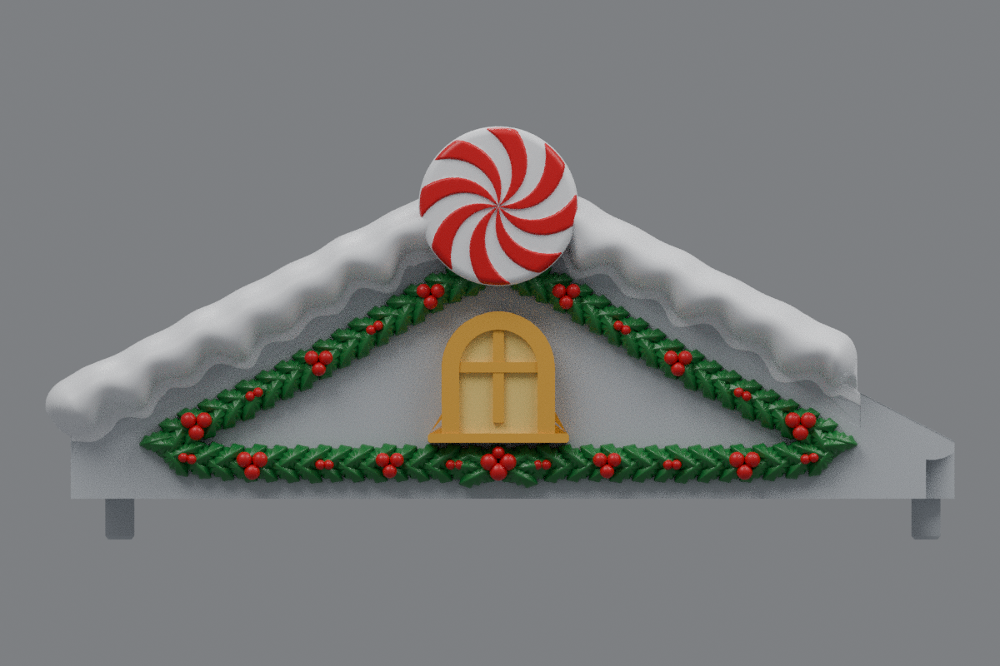
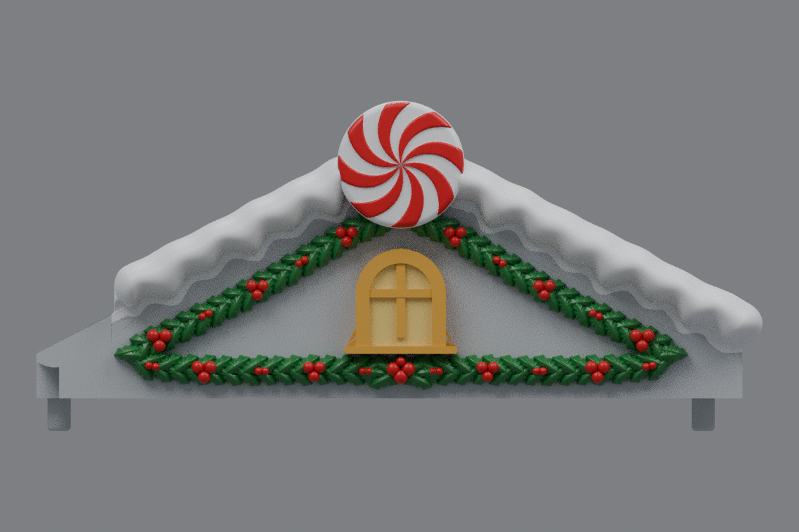

# Side roofs — filled snow contact and new holly (v15)

The current side roofs are [v17](../roof-customization-v17/README.md), with thicker lower holly and two added rows spanning the full bottom garland.

The gap beneath the shortened inner snow end is filled back into the roof and gable face. The rounded front profile and scalloped side drifts are retained. Both side roofs receive the same mirrored repair.

The old front holly and its remnants are removed to the original facade plane. A new triangular garland frames the centered window: two overlapping rows of domed, softly serrated leaves with midribs, round berry clusters, and a fuller border and leaf fan beneath the window. Each gable has 138 leaves and 54 berries. The original arch, panes, and mullions remain centered; a clean rounded sill replaces the old decorative sill shape.

The two-sided peppermint discs and the original mounting and inner-landing geometry are retained. Center **rev31 v12 remains unchanged**, pending your test print. The shortened snow tips remain snow-only; the new holly sits on the gable facade below them.

## Downloads

- [Left roof STL](https://github.com/brucebentle-del/codex-workspace/raw/refs/heads/main/roof-customization-v15/left_roof_rev10_center_style_snow_peppermint_v15.stl)
- [Right roof STL](https://github.com/brucebentle-del/codex-workspace/raw/refs/heads/main/roof-customization-v15/right_roof_rev10_center_style_snow_peppermint_v15.stl)
- [Unchanged center rev31 v12 STL](https://github.com/brucebentle-del/codex-workspace/raw/refs/heads/main/roof-customization-v12/center_roof_rev31_double_sided_peppermint_extended_holly_v12.stl)

Each STL is one fused, watertight material part. Preserve the original units and orientation; dimensions assume millimeters.

## Previews

These views use the exported meshes. Colors are painting guides; STL files contain geometry without colors. Gray close-ups show the repaired contact.

| View | Left roof | Right roof |
| --- | --- | --- |
| Front and new holly | [Preview](left-front-v15.png) | [Preview](right-front-v15.png) |
| Outer side | [Preview](left-outer-v15.png) | [Preview](right-outer-v15.png) |
| Repaired snow end, gray | [Close-up](left-tip-v15.png) | [Close-up](right-tip-v15.png) |

## Validation

[Contact and cleanup checks](snow-contact-and-cleanup-validation.json) compare v14 with the saved v15 files. Vertical sections cover both front snow slopes and densely sample the inner tip. No air interval greater than 0.03 mm remains above the roof in these sections. The cleaned structural body has no original front projections above the base, and the saved meshes are checked for old facade remnants.

Both saved STLs reload as watertight, consistently wound, positive-volume solids with one connected material part. [Mesh validation](mesh-validation.json) records hashes, dimensions, triangle counts, numerical cleanup, and mirror error. [Surface checks](surface-validation.json) compare original mounting and underside surfaces and the inner landing within 0.01 mm, the centered window front within 0.02 mm, and bare roof probes within 0.005 mm. They also confirm the center v12 checksum is unchanged.

[Snow profiles](snow-profile-validation.json), [peppermint relief](peppermint-pattern-validation.json), [holly dimensions](holly-dimensions.json), [design dimensions](side-design-dimensions.json), and the [original right-roof reflection](original-right-source-match.json) are included.

Physical printing and assembled fit still require a test print.
