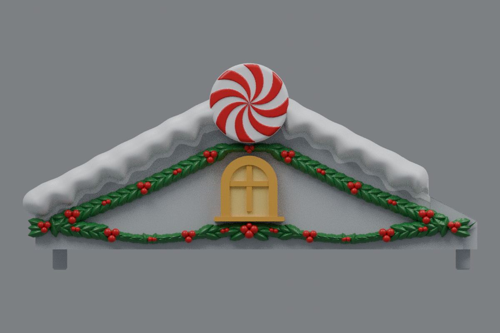
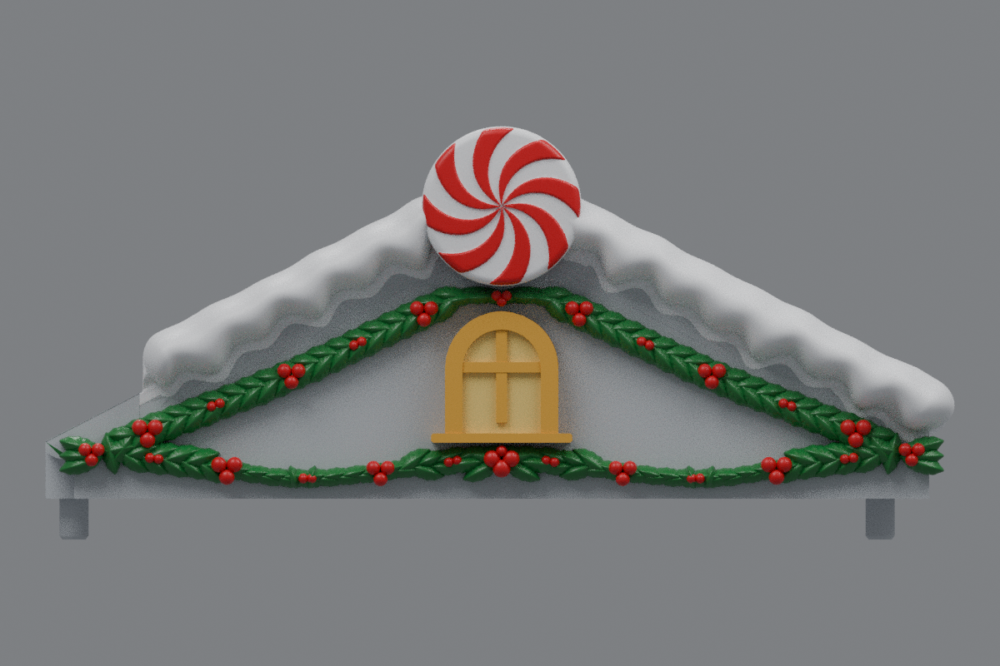

# Side roofs with draping holly (v16)

The current side roofs are [v20](../roof-customization-v20/README.md), with larger holly hugging the window arch and bold upper berries matching the lower cluster.

The lower holly now hangs in two curved swags that meet at a bolder center tie below the window. The top cluster is approximately 4.8 mm lower and sits visibly beneath the peppermint disc. Leaf fans extend toward both roof ends to fill the former bare areas, with softer leaf shapes closer to the reference.

Both side roofs mirror one another. Each garland has 177 leaves and 63 berries. The end leaf sprays stay in front of the gable outside the wall, preserving the original inner roof landing.

The v15 snow, repaired snow contact, centered windows and sills, and two-sided peppermint discs are retained. Center **rev31 v12 remains unchanged**, pending your test print.

## Downloads

- [Left roof STL](https://github.com/brucebentle-del/codex-workspace/raw/refs/heads/main/roof-customization-v16/left_roof_rev10_center_style_snow_peppermint_v16.stl)
- [Right roof STL](https://github.com/brucebentle-del/codex-workspace/raw/refs/heads/main/roof-customization-v16/right_roof_rev10_center_style_snow_peppermint_v16.stl)
- [Unchanged center rev31 v12 STL](https://github.com/brucebentle-del/codex-workspace/raw/refs/heads/main/roof-customization-v12/center_roof_rev31_double_sided_peppermint_extended_holly_v12.stl)

Each STL is one fused, watertight material part. Keep the original units and orientation; dimensions assume millimeters.

## Previews

These views use the exported meshes. Colors are painting guides; STL files contain geometry without colors.

| View | Left roof | Right roof |
| --- | --- | --- |
| Front layout | [Preview](left-front-v16.png) | [Preview](right-front-v16.png) |
| Angled view | [Preview](left-outer-v16.png) | [Preview](right-outer-v16.png) |

## Validation

[Holly layout checks](holly-layout-validation.json) measure the two lower dips, confirm that the new foliage leaves the disc and window unobstructed, and check that the end sprays add no holly roots behind the original body. The retained snow, window, sill, and disc component hashes match v15 in [retained-components.json](retained-components.json).

The saved STLs reload as watertight, consistently wound, positive-volume solids with one connected material part. [Mesh validation](mesh-validation.json) records hashes, bounds, triangle counts, numerical cleanup, and mirror error.

[Surface checks](surface-validation.json) compare original mounting and underside surfaces and the inner landing within 0.01 mm, the centered window front within 0.02 mm, and bare roof probes within 0.005 mm. They also confirm the center v12 checksum is unchanged.

[Snow contact checks](snow-contact-and-cleanup-validation.json), [snow profiles](snow-profile-validation.json), [peppermint relief](peppermint-pattern-validation.json), [holly dimensions](holly-dimensions.json), [design dimensions](side-design-dimensions.json), and the [original right-roof reflection](original-right-source-match.json) are included.

Physical printing and assembled fit still require a test print.
