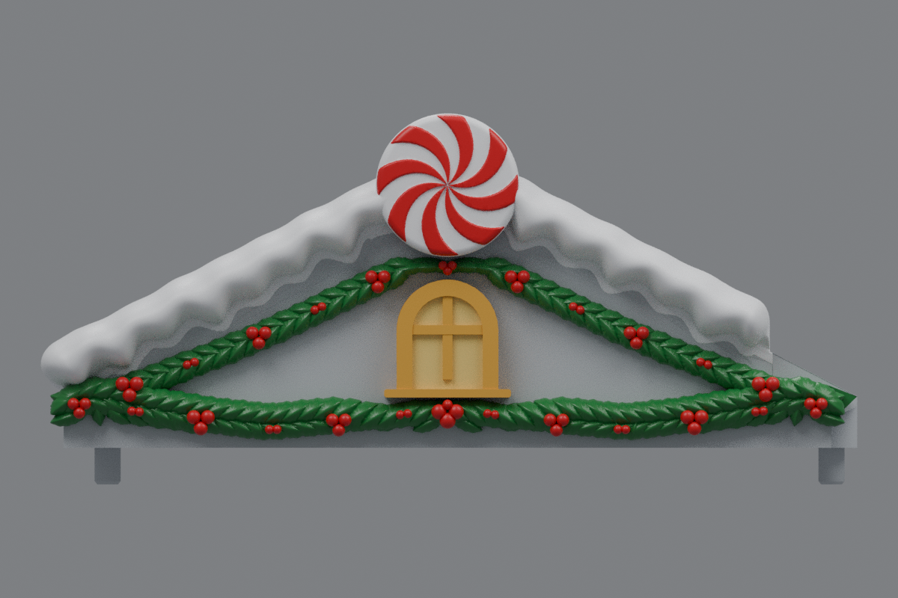
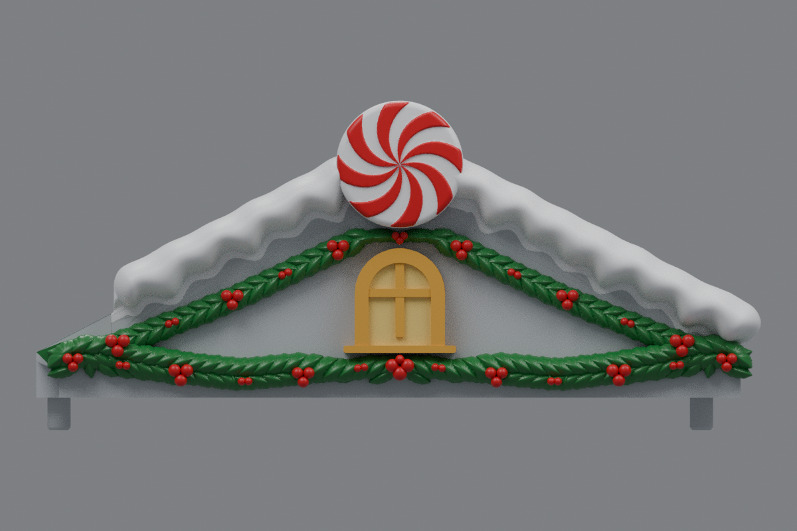

# Side roofs with thicker lower holly (v17)

The current side roofs are [v19](../roof-customization-v19/README.md), with a filled top holly gap, a larger bottom-center cluster and less upper drape.

Two additional overlapping rows of holly run across the **entire lower garland**, from one roof end to the other, including the draped valleys and center tie. The new rows add 100 wider, domed leaves per roof, while preserving the curved drape and existing end clusters.

The lower green foliage has about 77% more volume in front of the facade below Z = 15 mm. The fuller row projects 0.75 mm farther outward than the previous green foliage. Lower berry clusters project 1.2 mm farther outward to remain visible above the denser leaves; buried supports fuse them into the gable.

Both side roofs mirror one another. Each garland now has 277 leaves and 63 berries. The v16 upper holly, snow, windows, sills, peppermint discs, inner roof landings and mounting geometry are retained. Center **rev31 v12 remains unchanged**, pending your test print.

## Downloads

- [Left roof STL](https://github.com/brucebentle-del/codex-workspace/raw/refs/heads/main/roof-customization-v17/left_roof_rev10_center_style_snow_peppermint_v17.stl)
- [Right roof STL](https://github.com/brucebentle-del/codex-workspace/raw/refs/heads/main/roof-customization-v17/right_roof_rev10_center_style_snow_peppermint_v17.stl)
- [Unchanged center rev31 v12 STL](https://github.com/brucebentle-del/codex-workspace/raw/refs/heads/main/roof-customization-v12/center_roof_rev31_double_sided_peppermint_extended_holly_v12.stl)

Each STL is one fused, watertight material part. Keep the original units and orientation; dimensions assume millimeters.

## Previews

These views use the exported meshes. Colors are painting guides; STL files contain geometry without colors.

| View | Left roof | Right roof |
| --- | --- | --- |
| Front layout | [Preview](left-front-v17.png) | [Preview](right-front-v17.png) |
| Angled view | [Preview](left-outer-v17.png) | [Preview](right-outer-v17.png) |

## Validation

[Holly layout checks](holly-layout-validation.json) confirm that each added row spans the full bottom without gaps between leaf projections. They measure the added foliage, check window and disc clearance, confirm the upper holly is unchanged, and check that buried leaf and berry roots add no material outside the original structural body. End foliage remains in front of the gable outside the wall.

The snow, window, sill and disc component hashes match v16 in [retained-components.json](retained-components.json). The exported STLs reload as watertight, consistently wound solids with one connected material part. [Mesh validation](mesh-validation.json) records hashes, bounds, triangle counts, numerical cleanup and mirror error.

[Surface checks](surface-validation.json) compare original mounting and underside surfaces and the inner landing within 0.01 mm, the centered window front within 0.02 mm, and bare roof probes within 0.005 mm. They also confirm the center v12 checksum is unchanged.

[Snow contact checks](snow-contact-and-cleanup-validation.json), [snow profiles](snow-profile-validation.json), [peppermint relief](peppermint-pattern-validation.json), [holly dimensions](holly-dimensions.json), [design dimensions](side-design-dimensions.json), and the [original right-roof reflection](original-right-source-match.json) are included.

Physical printing and assembled fit require a test print.
