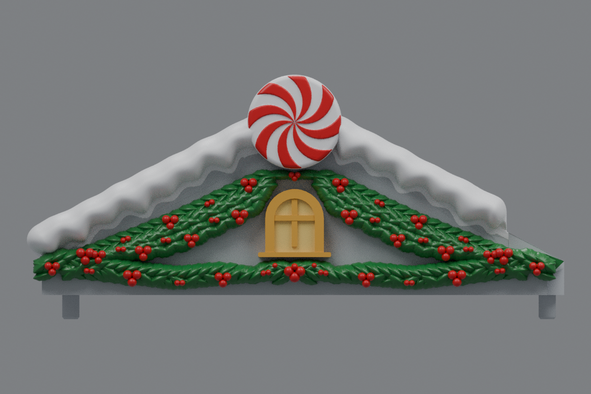
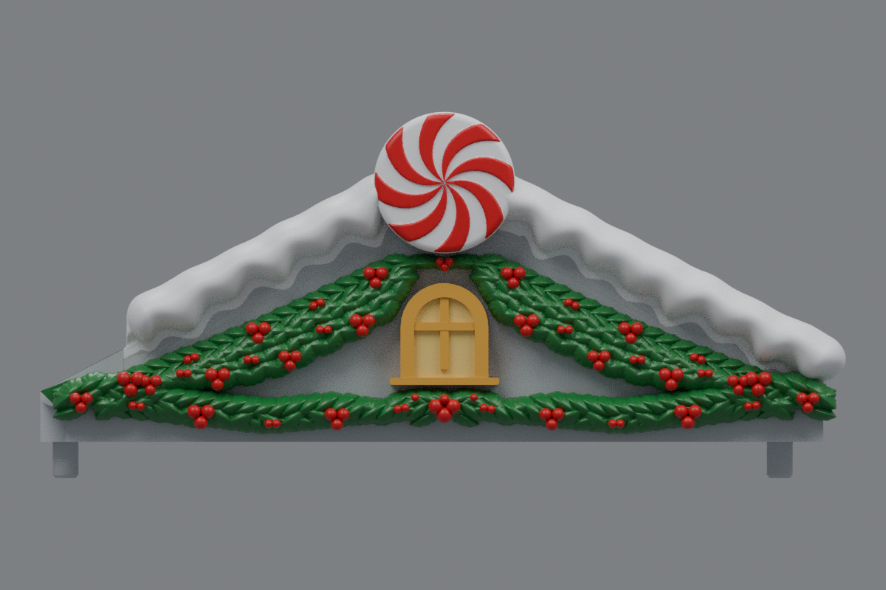

# Side roofs with lush draped holly and smaller windows (v18)

The current side roofs are [v20](../roof-customization-v20/README.md), with larger holly hugging the window arch and bold upper berries matching the lower cluster.

The upper holly edges still follow the straight roof slopes. Their lower edges now curve downward into fuller drapes, following the red sketch. Four new overlapping rows fill this wider band with broader domed leaves. An additional staggered row and fuller center fan enrich the bottom border.

The holly projects farther outward and has more berry clusters. Each roof has **498 leaves and 101 berries**, including 221 new leaves and 38 new berries. Green foliage volume in front of the facade increased by about 80% from v17. Its maximum outward relief increased by about 1.16 mm.

The centered window and sill are **12.5% smaller in width and height** (scale 0.875), about their existing combined center. The arched frame is now 18.2 mm wide and 19.6 mm high. Relief depth is retained so the frame and crossbars stay prominent.

The roofs mirror one another. The snow, peppermint discs, shortened inner snow finishes and mounting geometry are retained. Center **rev31 v12 remains unchanged**, pending a test print.

## Downloads

- [Left roof STL](https://github.com/brucebentle-del/codex-workspace/raw/refs/heads/main/roof-customization-v18/left_roof_rev10_center_style_snow_peppermint_v18.stl)
- [Right roof STL](https://github.com/brucebentle-del/codex-workspace/raw/refs/heads/main/roof-customization-v18/right_roof_rev10_center_style_snow_peppermint_v18.stl)
- [Unchanged center rev31 v12 STL](https://github.com/brucebentle-del/codex-workspace/raw/refs/heads/main/roof-customization-v12/center_roof_rev31_double_sided_peppermint_extended_holly_v12.stl)

Each STL is one fused, watertight material part. Keep the original units and orientation; dimensions assume millimeters.

## Previews

These views use the exported meshes. Colors are painting guides; STL files contain geometry without colors.

| View | Left roof | Right roof |
| --- | --- | --- |
| Front layout | [Preview](left-front-v18.png) | [Preview](right-front-v18.png) |
| Angled view | [Preview](left-outer-v18.png) | [Preview](right-outer-v18.png) |

## Validation

[Holly layout checks](holly-layout-validation.json) compare the outer silhouette against v17, measure the additional drape on the inside edges, verify the increased foliage and relief, and check the window and disc remain unobstructed. Buried leaf and berry roots add no material outside the original body. End foliage remains forward of the gable outside the wall.

The snow and peppermint component hashes match v17. [Retained components and window transforms](retained-components.json) record this and the exact window scaling. The saved STLs reload as watertight, consistently wound solids with one connected material part. [Mesh validation](mesh-validation.json) records hashes, bounds, triangle counts, numerical cleanup and mirror error.

[Surface checks](surface-validation.json) compare original mounting and underside surfaces and the inner landing within 0.01 mm, the scaled window front within 0.02 mm, and bare roof probes within 0.005 mm. They check the window dimensions and confirm the center v12 checksum is unchanged.

[Snow contact checks](snow-contact-and-cleanup-validation.json), [snow profiles](snow-profile-validation.json), [peppermint relief](peppermint-pattern-validation.json), [holly dimensions](holly-dimensions.json), [design dimensions](side-design-dimensions.json), and the [original right-roof reflection](original-right-source-match.json) are included.

Physical printing and assembled fit require a test print.
