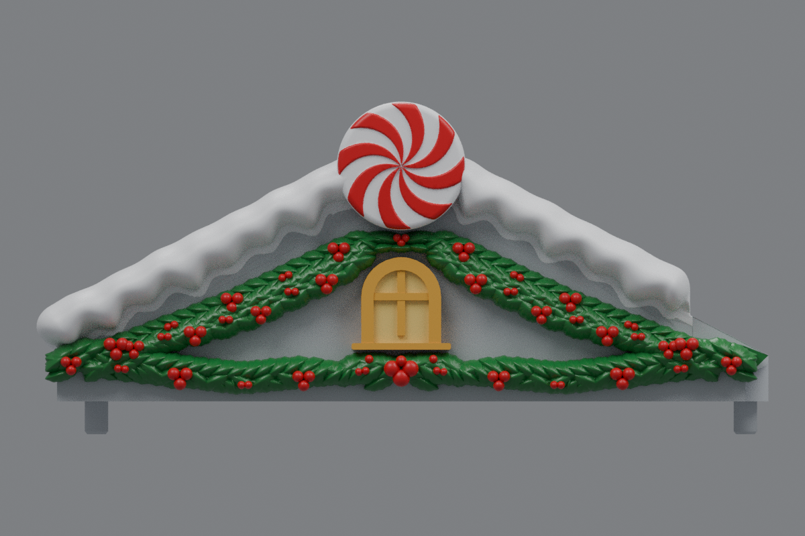
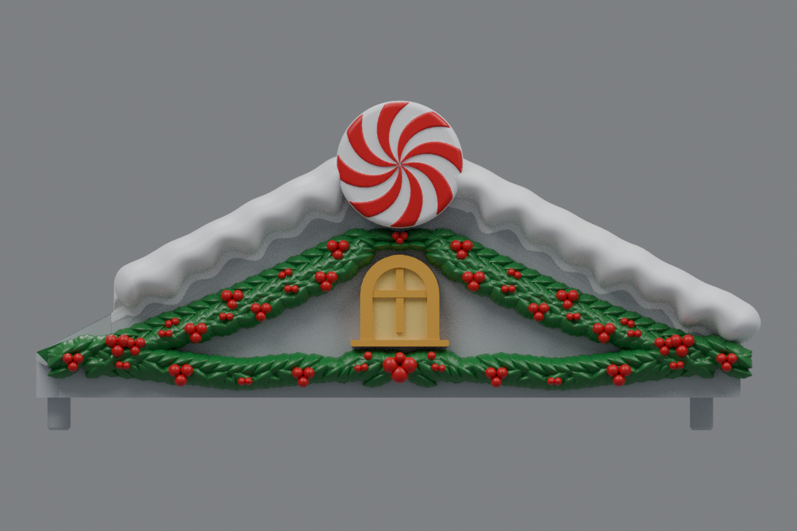

# Side roof holly refinements (v19)

The current side roofs are [v20](../roof-customization-v20/README.md), with larger holly hugging the window arch and bold upper berries matching the lower cluster.

The three marked areas are updated on both mirrored side roofs:

- A seven-leaf fan fills the space above the window in the white circle, with clearance around the arch and peppermint disc.
- The bottom-center leaves and main berry cluster in the black circle are about **20% larger** in width and height. The surrounding leaves blend into the larger center fan.
- The upper left and right holly drapes have about **one-third less sag**. Measurements at three positions average 33.6% less sag, while the straight outer edges stay close to the roof slopes.

Each roof has 505 leaves and 101 berries. The v18 windows, sills, snow and peppermint discs are retained. The windows remain 12.5% smaller than the original design; they have not been reduced again. Original mounting geometry and the shortened inner snow finishes are preserved. Center **rev31 v12 remains unchanged**, pending a test print.

## Downloads

- [Left roof STL](https://github.com/brucebentle-del/codex-workspace/raw/refs/heads/main/roof-customization-v19/left_roof_rev10_center_style_snow_peppermint_v19.stl)
- [Right roof STL](https://github.com/brucebentle-del/codex-workspace/raw/refs/heads/main/roof-customization-v19/right_roof_rev10_center_style_snow_peppermint_v19.stl)
- [Unchanged center rev31 v12 STL](https://github.com/brucebentle-del/codex-workspace/raw/refs/heads/main/roof-customization-v12/center_roof_rev31_double_sided_peppermint_extended_holly_v12.stl)

Each STL is one fused, watertight material part. Keep the original units and orientation; dimensions assume millimeters.

## Previews

These views use the exported meshes. Colors are painting guides; STL files contain geometry without colors.

| View | Left roof | Right roof |
| --- | --- | --- |
| Front layout | [Preview](left-front-v19.png) | [Preview](right-front-v19.png) |
| Angled view | [Preview](left-outer-v19.png) | [Preview](right-outer-v19.png) |

## Validation

[Holly layout checks](holly-layout-validation.json) measure the reduced sag, coverage of the gap above the window, and larger central berry and leaf projections. They verify that the outer silhouette stays in place, the window and disc remain unobstructed, and buried leaf and berry roots add no material outside the original body. End foliage remains forward of the gable outside the wall.

The snow, peppermint, window and sill component hashes match v18 in [retained-components.json](retained-components.json). The saved STLs reload as watertight, consistently wound solids with one connected material part. [Mesh validation](mesh-validation.json) records hashes, bounds, triangle counts, numerical cleanup and mirror error.

[Surface checks](surface-validation.json) compare original mounting and underside surfaces and the inner landing within 0.01 mm, the retained window front within 0.02 mm, and bare roof probes within 0.005 mm. They check the window dimensions and confirm the center v12 checksum is unchanged.

[Snow contact checks](snow-contact-and-cleanup-validation.json), [snow profiles](snow-profile-validation.json), [peppermint relief](peppermint-pattern-validation.json), [holly dimensions](holly-dimensions.json), [design dimensions](side-design-dimensions.json), and the [original right-roof reflection](original-right-source-match.json) are included.

Physical printing and assembled fit require a test print.
