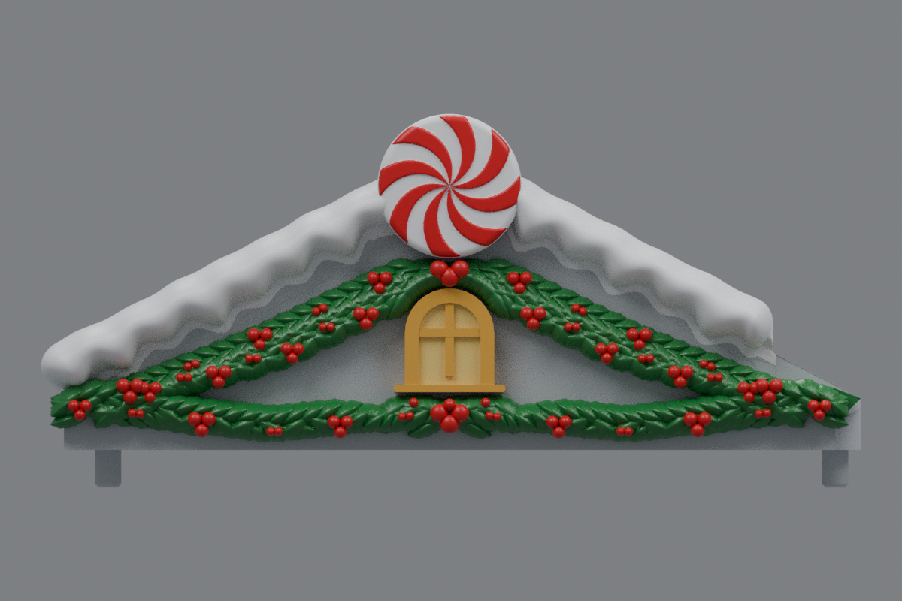
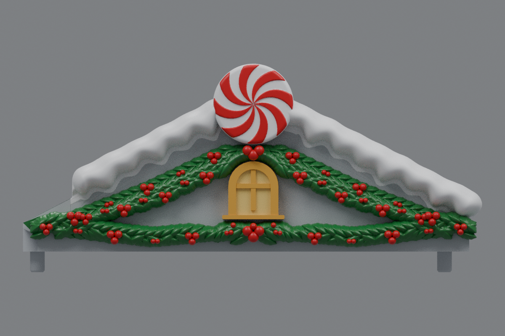

# Side roofs with holly hugging the window arch (v20)

The holly above the window now follows the curve of the arch closely. Nine larger leaves use the **same dimensions and outward relief as the oversized lower-center leaves**. Three bold upper berries use the same radii and front relief as the main berries below the window, arranged to fit between the arch and peppermint disc.

The top leaf fan and berries are centered on the window, and both side roofs mirror each other. The lower garland and side drapes retain their v19 profiles. Each roof has 507 leaves and 101 berries.

The v19 window, sill, snow, peppermint and original mounting geometry are retained. Center **rev31 v12 remains unchanged**, pending a test print.

## Downloads

- [Left roof STL](https://github.com/brucebentle-del/codex-workspace/raw/refs/heads/main/roof-customization-v20/left_roof_rev10_center_style_snow_peppermint_v20.stl)
- [Right roof STL](https://github.com/brucebentle-del/codex-workspace/raw/refs/heads/main/roof-customization-v20/right_roof_rev10_center_style_snow_peppermint_v20.stl)
- [Unchanged center rev31 v12 STL](https://github.com/brucebentle-del/codex-workspace/raw/refs/heads/main/roof-customization-v12/center_roof_rev31_double_sided_peppermint_extended_holly_v12.stl)

Each STL is one fused, watertight material part. Keep the original units and orientation; dimensions assume millimeters.

## Previews

These views use the exported meshes. Colors are painting guides; STL files contain geometry without colors.

| View | Left roof | Right roof |
| --- | --- | --- |
| Front layout | [Preview](left-front-v20.png) | [Preview](right-front-v20.png) |
| Angled view | [Preview](left-outer-v20.png) | [Preview](right-outer-v20.png) |

## Validation

[Holly layout checks](holly-layout-validation.json) measure the gap between the holly and the arch at eleven positions. The average is 0.38 mm. They compare top and lower leaf dimensions, berry sizes, and the foliage outside the modified top area. They verify clearance around the window and disc, and that buried roots add no material outside the original body.

The snow, peppermint, window and sill component hashes match v19 in [retained-components.json](retained-components.json). The saved STLs reload as watertight, consistently wound solids with one connected material part. [Mesh validation](mesh-validation.json) records hashes, bounds, triangle counts, numerical cleanup and mirror error.

[Surface checks](surface-validation.json) compare original mounting and underside surfaces and the inner landing within 0.01 mm, the retained window front within 0.02 mm, and bare roof probes within 0.005 mm. They measure matching front relief on the top and bottom berries, check the window dimensions and confirm the center v12 checksum is unchanged.

[Snow contact checks](snow-contact-and-cleanup-validation.json), [snow profiles](snow-profile-validation.json), [peppermint relief](peppermint-pattern-validation.json), [holly dimensions](holly-dimensions.json), [design dimensions](side-design-dimensions.json), and the [original right-roof reflection](original-right-source-match.json) are included.

Physical printing and assembled fit require a test print.
