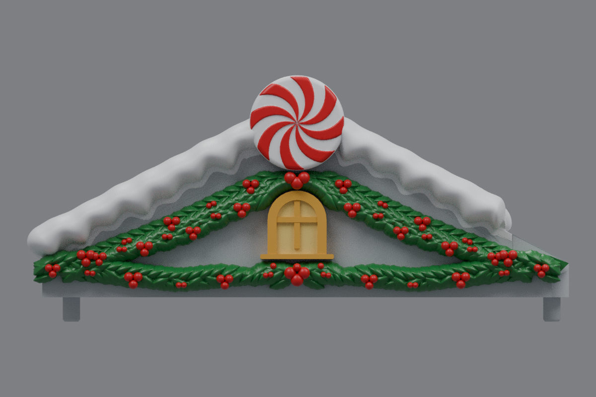
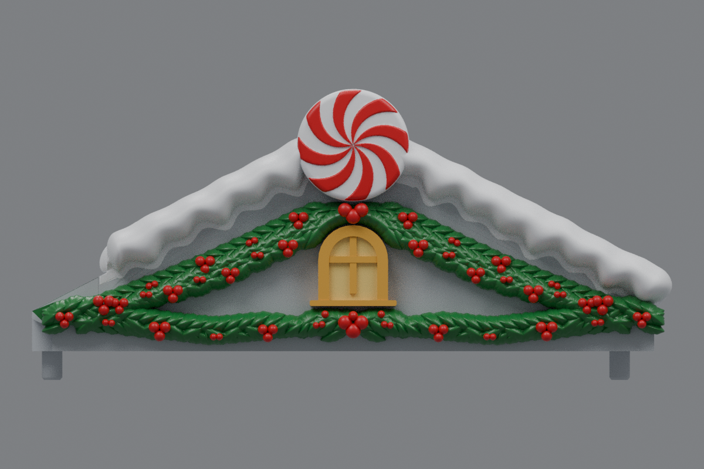

# Side roof window and snow-tip cleanup (v21)

This revision cleans the two remaining areas on both side roofs. The window keeps its intended raised arch and sill, while the stepped backing behind the arch has been replaced with one smooth, continuous return into the facade. The shortened inner snow ridge now ends in a rounded ellipsoidal cap instead of a flat clipped face. The cap stays inside the protected center-roof clearance.

The holly, berries, centered window layout, peppermint discs, snow profiles away from the inner tip, and original mounting geometry are retained from v20. The left and right roofs are mirrored. Center **rev31 v12 remains unchanged**, pending a test print.

## Downloads

- [Left roof STL](https://github.com/brucebentle-del/codex-workspace/raw/refs/heads/main/roof-customization-v21/left_roof_rev10_center_style_snow_peppermint_v21.stl)
- [Right roof STL](https://github.com/brucebentle-del/codex-workspace/raw/refs/heads/main/roof-customization-v21/right_roof_rev10_center_style_snow_peppermint_v21.stl)
- [Unchanged center rev31 v12 STL](https://github.com/brucebentle-del/codex-workspace/raw/refs/heads/main/roof-customization-v12/center_roof_rev31_double_sided_peppermint_extended_holly_v12.stl)

Each side STL is one fused, watertight material part. Keep the original units and orientation; dimensions assume millimeters.

## Previews

Colors in the front views are painting guides. STL files contain geometry without colors.

| View | Left roof | Right roof |
| --- | --- | --- |
| Front layout | [Preview](left-front-v21.png) | [Preview](right-front-v21.png) |
| Angled outer view | [Preview](left-outer-v21.png) | [Preview](right-outer-v21.png) |

- [Clean window return closeup](window-detail-v21.png)
- [Rounded inner snow tip closeup](snow-tip-detail-v21.png)

## Validation

[Cleanup validation](cleanup-validation.json) checks the window return at six depths, retains the exposed window front within numerical precision, verifies unchanged snow away from the inner tip, and measures the rounded cap against its ellipsoidal surface. The cap ends at X 135.65 mm on the left, inside the X 135.98 mm safety boundary; the right roof mirrors it.

[Mesh validation](mesh-validation.json) records hashes, bounds, triangle counts, watertightness, one-part connectivity, and mirror error. [Surface checks](surface-validation.json) compare original mounting, underside, inner landing, centered window, peppermint, and bare roof surfaces. [Snow contact checks](snow-contact-and-cleanup-validation.json) confirm the snow is part of the same watertight solid and distinguish the natural underside of the rounded tip from unintended internal gaps.

[Holly layout checks](holly-layout-validation.json), [snow profiles](snow-profile-validation.json), [peppermint relief](peppermint-pattern-validation.json), [design dimensions](side-design-dimensions.json), [cleanup dimensions](cleanup-dimensions.json), and the [original right-roof reflection](original-right-source-match.json) are included.

Physical printing and assembled fit require a test print.
