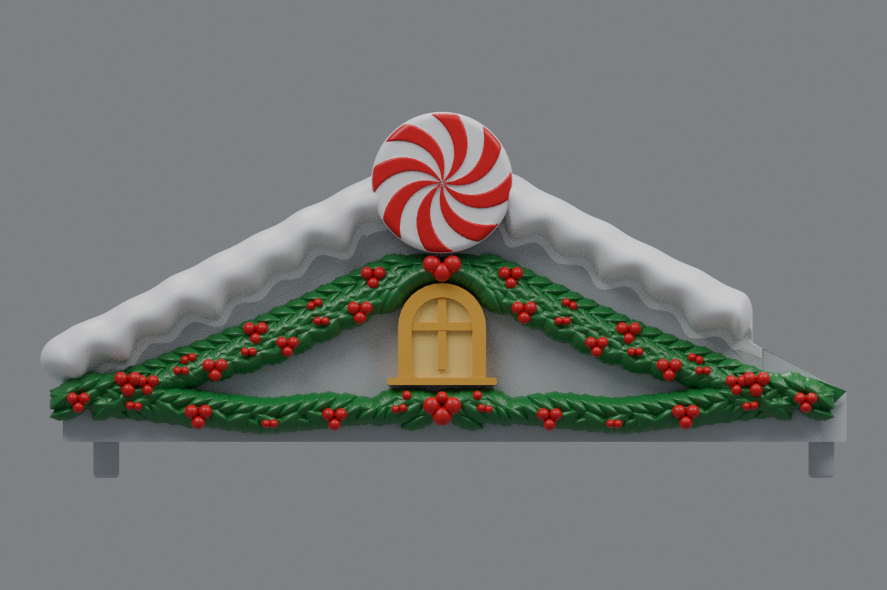
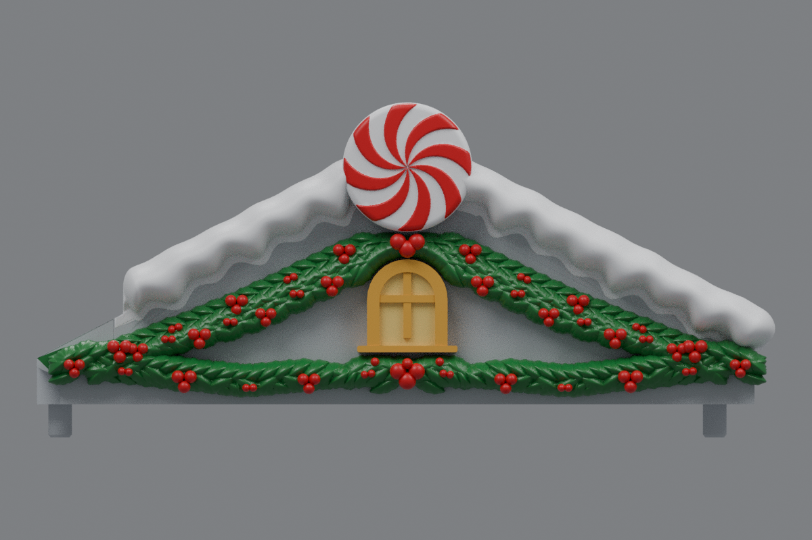

# Rounded side-roof snow ends (v22)

> Archived revision. The current side roofs are [v23](../roof-customization-v23/README.md).

This revision cleans the circled inner end of the snow ridge on both side roofs. The separate oval cap has been removed. The original snow surface is drawn inward within the protected center-roof clearance and locally smoothed into one continuous rounded end, without a blade, block, gap, or visible Boolean seam.

The left and right roofs are exact mirrors. The v21 window cleanup and the existing holly, berries, centered windows, peppermint discs, snow profiles away from the inner end, and mounting geometry are retained. Center **rev31 v12 remains unchanged**, pending a test print.

## Downloads

- [Left roof STL](https://github.com/brucebentle-del/codex-workspace/raw/refs/heads/main/roof-customization-v22/left_roof_rev10_center_style_snow_peppermint_v22.stl)
- [Right roof STL](https://github.com/brucebentle-del/codex-workspace/raw/refs/heads/main/roof-customization-v22/right_roof_rev10_center_style_snow_peppermint_v22.stl)
- [Unchanged center rev31 v12 STL](https://github.com/brucebentle-del/codex-workspace/raw/refs/heads/main/roof-customization-v12/center_roof_rev31_double_sided_peppermint_extended_holly_v12.stl)

Each side STL is one fused, watertight material part. Keep the original units and orientation; dimensions assume millimeters.

## Previews

Colors in the front views are painting guides. STL files contain geometry without colors.

| View | Left roof | Right roof |
| --- | --- | --- |
| Front layout | [Preview](left-front-v22.png) | [Preview](right-front-v22.png) |
| Angled outer view | [Preview](left-outer-v22.png) | [Preview](right-outer-v22.png) |

- [Rounded snow-end closeup](snow-tip-detail-v22.png)
- [Retained smooth window return](window-detail-v22.png)

## Validation

[Cleanup validation](cleanup-validation.json) confirms that no independent cap vertices or faces remain, 3,000 terminal vertices receive the local smoothing pass, the maximum displacement is 0.141 mm, and the left end remains at X=135.75 mm inside the X=135.98 mm safety boundary. The finished right roof is generated by exact reflection.

[Mesh validation](mesh-validation.json) records STL checksums, bounds, triangle counts, watertightness, winding, one connected material part, and a maximum reflected-vertex error below 0.001 mm. [Surface validation](surface-validation.json) verifies the mounting surfaces, underside, centered window, protected inner landing, peppermint size, and unchanged center-roof checksum.

[Snow contact checks](snow-contact-and-cleanup-validation.json), [snow profiles](snow-profile-validation.json), [holly layout](holly-layout-validation.json), [peppermint relief](peppermint-pattern-validation.json), [retained components](retained-components.json), [holly dimensions](holly-dimensions.json), [design dimensions](side-design-dimensions.json), and the [original right-roof reflection](original-right-source-match.json) are included.

Physical printing and assembled fit require a test print.
