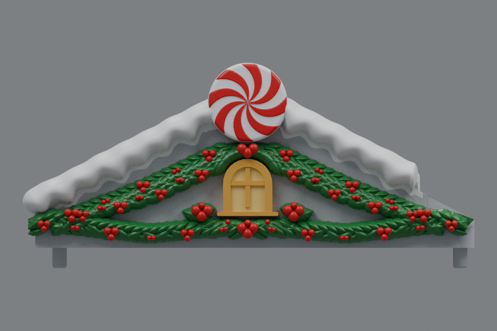
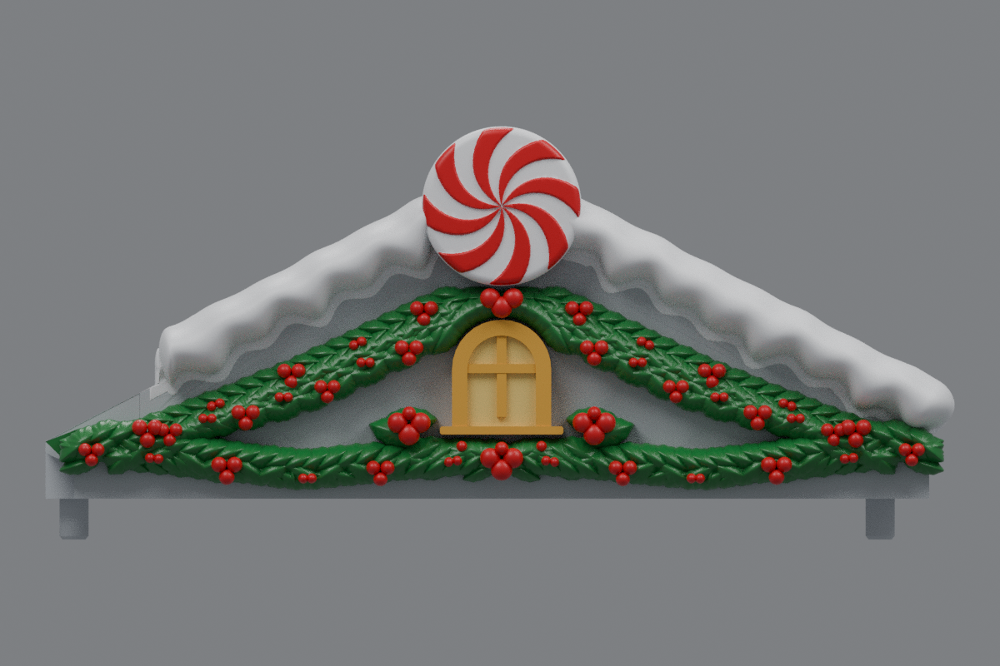

# Mirrored holly accents and fused rounded snow ends (v23)

This revision keeps the oversized three-berry holly cluster centered beneath the window and adds matching leaf-and-three-berry accents to the left and right window gaps. The added accents are uniform mirror images.

The shortened inner snow ridge on each roof now ends in a shallow rounded surface built into the existing snow topology. Its lower arc is fused to the roof, replacing the old flat cutoff without adding a separate cap or leaving an air gap. The left and right roofs are exact reflections.

The centered windows, peppermint discs, lush two-row holly, outer snow scallops, mounting geometry, and protected center-roof landing are retained. Center **rev31 v12 remains unchanged**, pending a test print.

## Downloads

- [Left roof STL](https://raw.githubusercontent.com/brucebentle-del/codex-workspace/refs/heads/main/roof-customization-v23/left_roof_rev10_center_style_snow_peppermint_v23.stl)
- [Right roof STL](https://raw.githubusercontent.com/brucebentle-del/codex-workspace/refs/heads/main/roof-customization-v23/right_roof_rev10_center_style_snow_peppermint_v23.stl)
- [Unchanged center rev31 v12 STL](https://raw.githubusercontent.com/brucebentle-del/codex-workspace/refs/heads/main/roof-customization-v12/center_roof_rev31_double_sided_peppermint_extended_holly_v12.stl)

Each side STL is one fused, watertight material part. Keep the original orientation and millimeter units.

## Previews

Colors are painting guides. STL files contain geometry without colors.

| View | Left roof | Right roof |
| --- | --- | --- |
| Front layout | [Preview](left-front-v23.png) | [Preview](right-front-v23.png) |
| Angled outer view | [Preview](left-outer-v23.png) | [Preview](right-outer-v23.png) |

- [Window and three retained/added holly accents](window-detail-v23.png)
- [Rounded, roof-fused inner snow end](snow-tip-detail-v23.png)

## Validation

[Cleanup validation](cleanup-validation.json) records removal of the 509-face flat terminal patch and its replacement with a seven-ring rounded surface that shares the existing snow boundary. [Snow contact checks](snow-contact-and-cleanup-validation.json) scan 2,717 sections on each finished STL and find zero roof-to-snow gaps.

[Holly layout validation](holly-layout-validation.json) confirms that the center accent remains present, both side gaps receive equal mirrored accents, and the holly clears the window and peppermint disc. [Mesh validation](mesh-validation.json) records checksums, bounds, 988,214 triangles per roof, watertightness, consistent winding, one connected material part, and reflection error below 0.001 mm.

[Surface validation](surface-validation.json) verifies the original mounting surfaces, underside, centered window, protected inner landing, peppermint size, and unchanged center-roof checksum. [Snow profiles](snow-profile-validation.json), [peppermint relief](peppermint-pattern-validation.json), [holly dimensions](holly-dimensions.json), [cleanup dimensions](cleanup-dimensions.json), [design dimensions](side-design-dimensions.json), [retained components](retained-components.json), and the [original right-roof reflection](original-right-source-match.json) are included.

Physical printing and assembled fit still require a test print.
