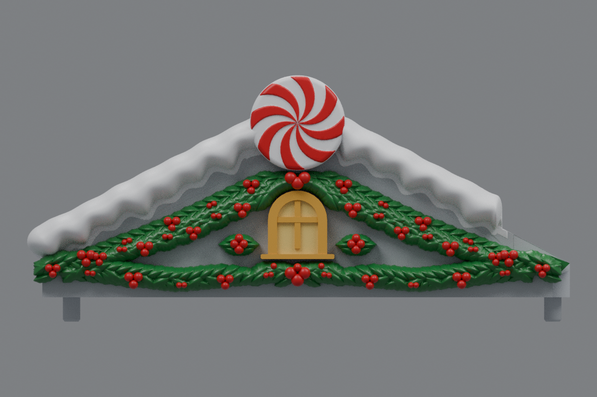
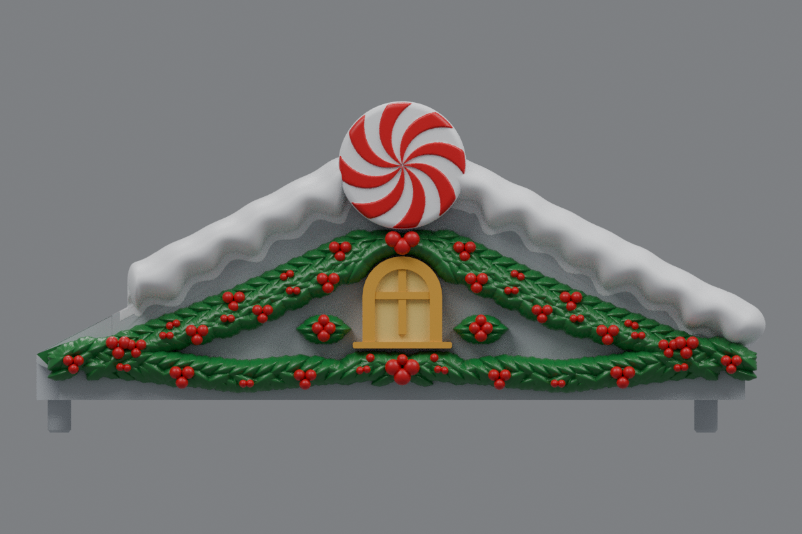

# Independent holly sprays and smooth rounded snow ends (v24)

This revision keeps the oversized three-berry holly cluster beneath the window and adds a separate compact spray on each side of the window. Each new spray has four berries surrounded by six leaves, is centered in the open wall space, and has a verified visible gap from the upper and lower garlands. The left and right arrangements are exact mirror images.

The shortened inner snow ridge on each roof now finishes as a continuous rounded roll. The former vertical tongue and oval cap are removed. The existing one-piece snow topology is drawn inward and locally blended, leaving no separate end disk, cap, or added Boolean seam.

The centered windows, double-sided peppermint discs, lush roof-hugging holly, lower garland, outer snow scallops, mounting geometry, and protected center-roof landing are retained. The side roofs remain unchanged. The current center is **rev31 v25**, with reinforced ribbon tails and attached holly following its test print.

## Downloads

- [Left roof STL](https://raw.githubusercontent.com/brucebentle-del/codex-workspace/refs/heads/main/roof-customization-v24/left_roof_rev10_center_style_snow_peppermint_v24.stl)
- [Right roof STL](https://raw.githubusercontent.com/brucebentle-del/codex-workspace/refs/heads/main/roof-customization-v24/right_roof_rev10_center_style_snow_peppermint_v24.stl)
- [Center rev31 v25 STL](https://raw.githubusercontent.com/brucebentle-del/codex-workspace/refs/heads/main/roof-customization-v25/center_roof_rev31_solid_ribbon_tails_anchored_holly_v25.stl)

Each side STL is one fused, watertight material part. Keep the original orientation and millimeter units.

## Previews

Colors are painting guides. STL files contain geometry without colors.

| View | Left roof | Right roof |
| --- | --- | --- |
| Front layout | [Preview](left-front-v24.png) | [Preview](right-front-v24.png) |
| Angled outer view | [Preview](left-outer-v24.png) | [Preview](right-outer-v24.png) |

- [Window with retained lower cluster and independent side sprays](window-detail-v24.png)
- [Continuous rounded inner snow end](snow-tip-detail-v24.png)

## Validation

[Holly layout validation](holly-layout-validation.json) confirms four berries and six leaves in each side spray, exact mirrored placement, retention of the lower-center cluster, no overlap with the window or peppermint disc, and at least 0.25 mm of projected visual separation from the rest of the garland.

[Cleanup validation](cleanup-validation.json) records zero added cap vertices or faces, 2,915 locally smoothed terminal vertices, and a maximum smoothing displacement of 0.158 mm. [Snow contact checks](snow-contact-and-cleanup-validation.json) scan 2,717 sections on each finished STL and find zero roof-to-snow gaps.

[Mesh validation](mesh-validation.json) records checksums, bounds, 1,007,830 triangles per roof, watertightness, consistent winding, one connected material part, and reflection error below 0.001 mm. [Surface validation](surface-validation.json) verifies the original mounting surfaces, underside, centered window, protected inner landing, peppermint size, and unchanged center-roof checksum.

[Snow profiles](snow-profile-validation.json), [peppermint relief](peppermint-pattern-validation.json), [holly dimensions](holly-dimensions.json), [cleanup dimensions](cleanup-dimensions.json), [design dimensions](side-design-dimensions.json), [retained components](retained-components.json), and the [original right-roof reflection](original-right-source-match.json) are included.

Physical printing and assembled fit still require a test print.
