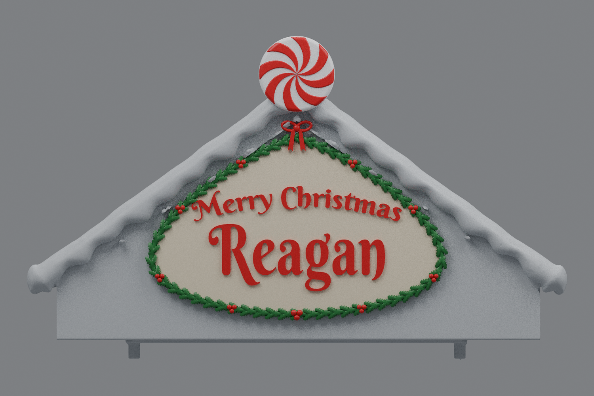

# Center rev31 — smaller peppermint and reference-style sign (v8)

This is an earlier version. The current [rev31 v9](../roof-customization-v9/README.md) removes the old holly remnants and adds fuller holly and a broader ribbon bow.

The peppermint is **25% smaller**: its diameter changes from 46 to **34.5 model units** (34.5 mm at the original millimeter scale). All disc dimensions are scaled uniformly to 75% about its attachment at the gable peak, so it remains fused to the snow.

The old rough sign lettering and double outline are replaced with a smooth cream sign field, arched decorative “Merry Christmas” lettering, a larger “Reagan,” and a pointed holly-and-berry frame with a small bow beneath the peppermint. The wording is unchanged. The snow scallops, rounded roof tips, mounting geometry, and roof scale/orientation are retained.

## Download

[Download the fused rev31 STL](https://github.com/brucebentle-del/codex-workspace/raw/refs/heads/main/roof-customization-v8/center_roof_rev31_small_peppermint_reference_sign_v8.stl)

This is one closed, fused material part, including all letters, leaves, berries, bow, and peppermint. Rev31 remains the only center version in current downloads. The left and right roofs remain at v4: [left](../roof-customization-v4/left_roof_rev10_inner_snow_flat_scalloped_snow_v4.stl), [right](../roof-customization-v4/right_roof_rev10_inner_snow_flat_mirrored_scalloped_snow_v4.stl).

## Previews

These renders use the exported mesh. Cream, red, green, and white illustrate painting; the STL itself stores geometry without colors.

- [Sign close-up with painting guide](sign-paint-guide-v8.png)
- [Unpainted sign geometry in gray](sign-solid-v8.png)

## Construction and checks

The former sign relief is cleared from the front facade, with the snow protected from the cut. The new sign field overlaps the facade, and the sign details and resized peppermint are Boolean-fused into the roof. Original lettering is replaced rather than left behind the new text. Raised lettering is 1.15 model units deep. Dimensions are recorded in [sign-dimensions.json](sign-dimensions.json) and [peppermint-dimensions.json](peppermint-dimensions.json).

The saved STL reloads as watertight, with consistent winding, positive volume, and one connected material part. Hash, bounds, and construction measurements are in [mesh-validation.json](mesh-validation.json). Saved-file surface comparisons check original mounting surfaces and functional underside within 0.01 model units, the retained v7 snow and lower front lip outside the peppermint within 0.02, and bare roof-plane probes within 0.005. The peppermint diameter is measured directly from the saved mesh in both X and Z. Results and sample counts are in [surface-validation.json](surface-validation.json).

The lettering uses Berkshire Swash by Brian J. Bonislawsky / Astigmatic, available under the [SIL Open Font License](BerkshireSwash-OFL.txt). Font outlines are converted to solid geometry; no font installation is needed to use the STL.

These are mesh and geometry checks; physical printing and assembly have not been tested. Import with the same units as the original files.
