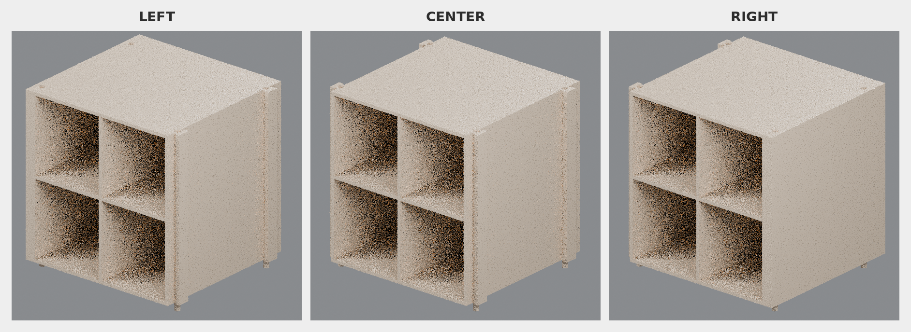

# Champagne-color upper bases (v1)

These 3MF files convert the approved Rev96 upper-base STLs to the Champagne color shown in the Candy-Cane Village reference. The complete upper-base geometry is assigned **Champagne Silk PLA** (`#C89A6B`).

The original left, center, and right geometry is preserved, including handedness, dimensions, mounts, and the **0.20 mm clearance** features. Roofs, drawer fronts, and candy-cane connector columns remain separate models.

## 3MF files

- `left_upper_base_rev96_clearance_0p20mm_champagne_v1.3mf`
- `center_upper_base_rev96_clearance_0p20mm_champagne_v1.3mf`
- `right_upper_base_rev96_clearance_0p20mm_champagne_v1.3mf`

In Bambu Studio, map **Champagne Silk PLA** to the intended AMS slot. Keep every model at 100% scale in millimeters.

## Dimensions

| Upper base | Source revision | Overall dimensions (X × Y × Z) |
|---|---:|---:|
| Left | rev96, 0.20 mm clearance | 162.25 × 150.50 × 165.10 mm |
| Center | rev96, 0.20 mm clearance | 162.00 × 150.50 × 165.10 mm |
| Right | rev96, 0.20 mm clearance | 162.25 × 150.50 × 165.10 mm |

## Validation

- Standard 3MF Core 1.0 archive with Materials Extension
- One explicit Champagne Silk PLA assignment on every triangle
- All three files reopen as watertight, consistently wound, positive-volume solids
- Source-to-3MF bounds error: **0 mm**
- Source-to-3MF volume error: **0 mm³**

See `3mf-validation-report.json` for checksums, exact bounds, volumes, and archive checks.
